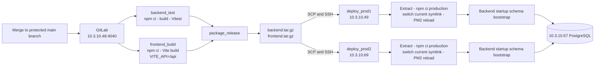
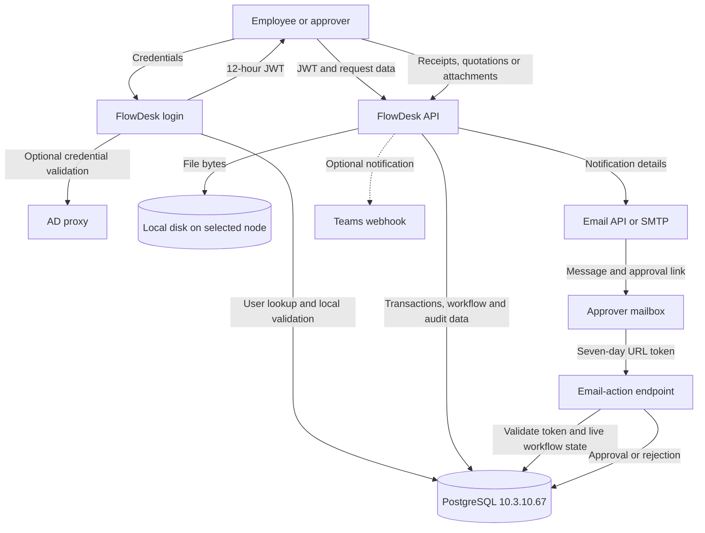

# FlowDesk Security, Penetration Test, and Audit Architecture Pack

**Classification:** Internal Confidential  
**System:** FlowDesk / Advance Clearance System  
**Document version:** 1.1  
**Prepared:** 2026-08-12  
**Repository baseline:** `main` at `f1cf358`, including the working tree state reviewed on 2026-08-12  
**Intended readers:** Security testing team, penetration testers, internal audit, external audit, system owners, infrastructure team, database administrators

## 1. Document Control and Approval

This document is a combined architecture, security-test scoping, and audit-evidence guide. It does not itself authorize penetration testing or certify that a control is effective.

| Responsibility | Name | Role | Approval/date |
|---|---|---|---|
| Business owner | To be completed | Accountable for business process and data | |
| System owner | To be completed | Accountable for FlowDesk | |
| Technical owner | To be completed | Application and deployment owner | |
| Information owner | To be completed | Employee and financial data owner | |
| Infrastructure owner | To be completed | Network, load balancer, production hosts | |
| Database owner | To be completed | PostgreSQL administration and backups | |
| Security owner | To be completed | Security testing and risk acceptance | |
| Audit owner | To be completed | Audit scope and evidence acceptance | |

### Change History

| Version | Date | Change | Author/approver |
|---|---|---|---|
| 1.0 | 2026-08-12 | Initial combined architecture, test scope, and audit pack | To be approved |
| 1.1 | 2026-08-12 | Added section 19 (repository cross-check findings); annotated N-04, N-05, and R-08 with confirmed code-level evidence | To be approved |

## 2. Purpose and Audience Guide

### Security and Penetration Test Team

Use sections 4-12 to understand network paths, trust boundaries, application entry points, integrations, data stores, and expected security controls. Complete and approve section 13 before active testing.

### Audit Team

Use sections 3-12 as the system and data-flow description. Use sections 14-16 to request evidence, record control conclusions, track exceptions, and connect findings to accountable owners.

### System and Infrastructure Owners

Confirm all entries marked **TBC** before distributing this document as an authoritative production record. Do not insert passwords, JWT secrets, database credentials, webhook secrets, private keys, or complete approval tokens into this document.

## 3. System Summary

FlowDesk is an internal employee workflow system for:

- travel and salary advances;
- post-travel clearance and expense claims;
- accommodation requests and quotations;
- overtime requests and claims;
- standby rosters and claims;
- attendance records;
- custom request forms and approval chains;
- payroll deduction tracking;
- configurable workflows, organization structure, delegation, PDF generation, notifications, and reporting.

The production deployment is active-active at the application tier. Both application nodes connect to one shared PostgreSQL database. Application binaries are deployed from GitLab CI/CD. Uploaded files and application logs are stored locally on each application node unless infrastructure outside this repository provides synchronization.

## 4. Confirmed Production Asset Register

| Asset | Address | Function | Key technology | Status/source |
|---|---|---|---|---|
| GitLab | `10.3.10.48:4040` | Source control and CI/CD coordination | GitLab | Confirmed by owner and deployment runbook |
| Production node 1 | `10.3.10.49` | SPA, reverse proxy, Express API, local files/logs | nginx, Node.js, PM2 | Confirmed by owner |
| Production node 2 | `10.3.10.69` | SPA, reverse proxy, Express API, local files/logs | nginx, Node.js, PM2 | Confirmed by owner |
| Production database | `10.3.10.67:5432` | Shared application data store | PostgreSQL 16 | Confirmed by owner; port derived from PostgreSQL default |
| Load balancer | **TBC** | Distributes user traffic to both production nodes | **TBC** | Architecture documentation confirms presence; address/product unconfirmed |
| GitLab runner | **TBC** | Executes build, test, package, and deploy jobs | GitLab shell runner | Host/address unconfirmed |
| AD/LDAP proxy | **TBC** | Optional enterprise authentication | HTTP API | Production URL/IP and TLS status unconfirmed |
| Internal email API | **TBC** | Primary notification delivery | HTTP API | Code default is `10.1.10.105`; production value must be verified |
| SMTP service | **TBC/optional** | Notification fallback | SMTP | Enabled status, host, port, and TLS mode unconfirmed |
| Teams webhook | **TBC/optional** | Channel notifications | HTTPS webhook | Enabled status unconfirmed |
| Email-action proxy | **TBC/optional** | Restricted access to approval-by-email routes | Reverse proxy | Production address and routing unconfirmed |

## 5. Production Deployment Diagram

```mermaid
flowchart TB
    classDef user fill:#e8f3ff,stroke:#1769aa,color:#111
    classDef edge fill:#fff3cd,stroke:#a66b00,color:#111
    classDef app fill:#e8f5e9,stroke:#287d3c,color:#111
    classDef data fill:#fdecea,stroke:#b3261e,color:#111
    classDef cicd fill:#f2eafa,stroke:#6f42c1,color:#111
    classDef ext fill:#eef0f2,stroke:#4f5963,color:#111
    classDef local fill:#fff0f3,stroke:#a61e4d,color:#111

    Users[Internal users and approvers]:::user
    LB[Production load balancer<br/>Address and TLS termination TBC]:::edge

    subgraph CICD[CI/CD trust zone]
        GitLab[GitLab<br/>10.3.10.48:4040]:::cicd
        Runner[GitLab shell runner<br/>Host TBC]:::cicd
        Jobs[Test - Build - Package<br/>deploy_prod1 and deploy_prod2]:::cicd
        GitLab --> Runner --> Jobs
    end

    subgraph P1[Production node 1 - 10.3.10.49]
        N1[nginx<br/>80 or 443]:::edge
        F1[React SPA static server<br/>127.0.0.1:5174]:::app
        A1[Express API<br/>127.0.0.1:4000 default]:::app
        U1[Local uploads]:::local
        L1[Local logs]:::local
        E1[/etc/advance-clearance/.env]:::local
        N1 -->|Static content| F1
        N1 -->|/api prefix removed| A1
        E1 --> A1
        A1 --> U1
        A1 --> L1
    end

    subgraph P2[Production node 2 - 10.3.10.69]
        N2[nginx<br/>80 or 443]:::edge
        F2[React SPA static server<br/>127.0.0.1:5174]:::app
        A2[Express API<br/>127.0.0.1:4000 default]:::app
        U2[Local uploads]:::local
        L2[Local logs]:::local
        E2[/etc/advance-clearance/.env]:::local
        N2 -->|Static content| F2
        N2 -->|/api prefix removed| A2
        E2 --> A2
        A2 --> U2
        A2 --> L2
    end

    DB[(Shared PostgreSQL 16<br/>10.3.10.67:5432)]:::data
    AD[AD/LDAP authentication proxy<br/>Production endpoint TBC]:::ext
    Mail[Internal HTTP email API<br/>Production endpoint TBC]:::ext
    SMTP[Optional SMTP fallback]:::ext
    Teams[Optional Teams webhook]:::ext
    EmailProxy[Optional restricted<br/>email-action proxy]:::edge

    Users -->|HTTPS preferred| LB
    LB --> N1
    LB --> N2
    A1 -->|TCP 5432| DB
    A2 -->|TCP 5432| DB
    A1 --> AD
    A2 --> AD
    A1 --> Mail
    A2 --> Mail
    A1 -.-> SMTP
    A2 -.-> SMTP
    A1 -.-> Teams
    A2 -.-> Teams
    Users -. Approval link .-> EmailProxy
    EmailProxy -. /email-actions only .-> A1
    EmailProxy -. /email-actions only .-> A2
    Jobs -->|SSH and SCP - TCP 22| P1
    Jobs -->|SSH and SCP - TCP 22| P2
```

## 6. CI/CD and Deployment Flow



Deployment characteristics relevant to both teams:

- GitLab stores the SSH private deploy key as a protected, masked CI/CD variable.
- The runner transfers release archives and `remote-deploy.sh` to both nodes over SSH/SCP.
- Production secrets reside outside each release at `/etc/advance-clearance/.env`.
- PM2 reloads the application after the `current` symlink is changed.
- Each node retains the three most recent releases.
- Both deployment jobs may operate independently against the two nodes.
- Each backend runs `bootstrapSystem()` at startup and performs idempotent DDL and data backfills against the shared database.
- Database-backed tests currently return early when the configured test database is unavailable; a green pipeline does not prove that all end-to-end database workflows ran.

## 7. Logical Application Architecture

```mermaid
flowchart LR
    Browser[React SPA<br/>JWT in localStorage] -->|JSON or multipart<br/>Bearer JWT| MW
    EmailUser[Email approval browser] -->|Token in URL path| EA

    subgraph API[Express API on each production node]
        MW[Helmet - compression - CORS<br/>2 MB JSON limit - request logger<br/>error handler]
        Auth[Local bcrypt login<br/>Optional AD login<br/>12-hour signed JWT]
        Access[Roles - permission groups<br/>feature permissions - org scope<br/>manager delegations]
        WF[Configurable workflow engine<br/>resolved and frozen approval chains]
        Notify[HTTP email API<br/>SMTP fallback - Teams webhook]
        PDF[PDFKit and configurable templates]
        EA[Email actions<br/>GET confirmation<br/>POST approve or reject]
        Scheduler[Daily change-request follow-up scheduler]
        MW --> Auth --> Access --> WF
        EA --> WF
    end

    subgraph Domain[Application modules]
        Advances[/advances]
        Claims[/claims]
        Accommodation[/accommodation]
        Attendance[/attendance]
        Overtime[/overtime]
        Standby[/standby]
        Custom[/custom-requests]
        Inbox[/inbox]
        Travel[/travel]
        Workflows[/workflows]
        Reporting[/reporting-lines]
        Types[/request-types]
        Deductions[/deductions]
        Templates[/pdf-templates]
        AI[/ai - local parsing only]
        Admin[/auth administration]
        Health[/health]
    end

    WF --> Domain
    Domain --> Notify
    Domain --> PDF
    Scheduler --> Notify
    DB[(Shared PostgreSQL<br/>10.3.10.67)]
    Files[(Node-local file storage)]
    Logs[(Node-local logs)]
    API --> DB
    Claims --> Files
    Accommodation --> Files
    Custom --> Files
    Templates --> Files
    MW --> Logs
```

The `/ai` module performs local keyword and regular-expression parsing over reporting data. No external AI or large-language-model service is used by the reviewed code.

## 8. Authentication, Authorization, and Trust Model

### Authentication

- Local authentication uses a user identifier and bcrypt password hash.
- Optional enterprise authentication sends credentials to an AD/LDAP HTTP proxy.
- AD authentication can be configured to allow or deny local fallback.
- Successful authentication returns a JWT signed with the backend `JWT_SECRET`.
- JWTs expire after 12 hours and are stored in browser `localStorage`.
- An administrative global-session timestamp can invalidate all tokens issued before it.
- Email approval tokens are separate JWTs with a seven-day expiry and server-side token records.

### Authorization

- Primary roles: `EMPLOYEE`, `MANAGER`, `HOD`, `FINANCE`, `ADMIN`, `EXCO`, and `CEO`.
- Additional access can be granted through permission groups and configurable feature permissions.
- Organization scope uses Division, Department, Section, Team, leadership assignments, and explicit reporting lines.
- Delegations allow an eligible manager's approval responsibilities to be temporarily assigned to another user.
- Workflow chains may resolve approvers by position, group, named user, department, section, or team.
- Authorization is enforced in Express routes and shared authorization helpers. Frontend visibility is not considered a security boundary.

### Public or Pre-authentication Endpoints

| Endpoint | Authentication model | Purpose |
|---|---|---|
| `GET /health` | None | Liveness response |
| `POST /auth/login` | Username/password, rate limited | Obtain JWT |
| `GET /email-actions/:token` | Token in URL | Read-only approval confirmation page/data |
| `POST /email-actions/:token/confirm` | Token in URL, rate limited | Approve or reject a current workflow step |

All other mounted business routes are intended to require a bearer JWT.

## 9. Data Stores and Information Flows

### Shared PostgreSQL Database: `10.3.10.67`

The database contains or controls:

- user profiles, employee numbers, email addresses, phone numbers, organization membership, roles, password hashes, and account status;
- reporting lines, leadership assignments, delegations, permission groups, and feature permissions;
- advances, payment methods, masked or complete payment destination data, totals, payment references, and workflow histories;
- clearance claims, receipts metadata, travel details, settlement details, deductions, and audit events;
- accommodation, attendance, overtime, standby, and custom request records;
- workflow definitions, resolved approval chains, request types, PDF templates, session settings, and email-action token records.

The application connection uses a PostgreSQL pool with a maximum of 20 connections per API process. With one API process on each production node, the expected application maximum is at least 40 database connections, excluding administrative, monitoring, backup, or additional PM2 processes.

### Node-local File Storage

The code stores uploaded data on the application node filesystem:

- clearance receipts;
- accommodation quotations;
- custom-request attachments;
- PDF letterhead/logo uploads;
- local application logs and archived logs.

These files are not stored in PostgreSQL and no replication or shared object storage is defined in the repository. A request routed to the other production node may be unable to retrieve a file created on the first node unless infrastructure provides external synchronization or load-balancer persistence.

### Data Flow Diagram



## 10. Network Connection Register

| ID | Source | Destination | Expected protocol/port | Data/purpose | Required control/evidence |
|---|---|---|---|---|---|
| N-01 | Internal user network | Load balancer | HTTPS `443/TCP`; HTTP behavior TBC | SPA, credentials, JWTs, business data | TLS configuration, certificate, redirect policy, WAF/LB policy |
| N-02 | Load balancer | `10.3.10.49` | `80/TCP` or `443/TCP` | User traffic | Firewall rule, health check, forwarding headers |
| N-03 | Load balancer | `10.3.10.69` | `80/TCP` or `443/TCP` | User traffic | Firewall rule, health check, forwarding headers |
| N-04 | nginx on each node | `127.0.0.1:5174` | HTTP | Static React assets | Loopback binding/listener evidence — **repository code does not enforce this; see section 19.1** |
| N-05 | nginx on each node | `127.0.0.1:4000` | HTTP | Express API | Loopback binding/listener evidence — **repository code does not enforce this; see section 19.1** |
| N-06 | `10.3.10.49` | `10.3.10.67` | PostgreSQL `5432/TCP` | Application data | Firewall rule, database grants, TLS status |
| N-07 | `10.3.10.69` | `10.3.10.67` | PostgreSQL `5432/TCP` | Application data | Firewall rule, database grants, TLS status |
| N-08 | GitLab runner | `10.3.10.48:4040` | HTTP per runbook | CI coordination | Runner registration and network rule |
| N-09 | GitLab runner | `10.3.10.49:22` | SSH/SCP | Deployment | Restricted key, source allowlist, SSH logs |
| N-10 | GitLab runner | `10.3.10.69:22` | SSH/SCP | Deployment | Restricted key, source allowlist, SSH logs |
| N-11 | Both API nodes | AD proxy TBC | HTTP/HTTPS TBC | Credential verification | TLS, service authentication, timeout, logging/redaction |
| N-12 | Both API nodes | Email API TBC | HTTP/HTTPS TBC | Email message delivery | TLS, API authentication, sensitive-data handling |
| N-13 | Both API nodes | SMTP TBC | SMTP/SMTPS TBC | Optional email fallback | TLS, relay restrictions, service credentials |
| N-14 | Both API nodes | Teams webhook | HTTPS `443/TCP` | Optional notifications | Secret storage and outbound allowlist |
| N-15 | Email-action proxy TBC | API node(s) | HTTP/HTTPS TBC | Approval links only | Exact path allowlist and access logs |

## 11. Security Boundaries and Expected Controls

| Boundary | Assets separated | Primary risks | Expected controls |
|---|---|---|---|
| User to load balancer | Browsers and production network | Interception, weak TLS, hostile input, session theft | HTTPS, secure headers, restricted CORS, rate limiting, monitoring |
| Load balancer to production nodes | Edge and application hosts | Direct-node bypass, spoofed forwarding headers | Network allowlist, trusted-proxy configuration, health checks |
| nginx to local services | Reverse proxy and application processes | Direct API/static-server exposure | Loopback binding, host firewall, least-privilege services |
| API to database | Application and authoritative data | Credential theft, excessive grants, injection, unencrypted traffic | Dedicated DB role, TLS, network ACL, parameterized SQL, backups |
| API to AD | Application and identity provider | Credential disclosure, fail-open behavior, impersonation | TLS, strict timeout/fallback policy, redacted logs |
| API to notification services | Application and external/internal messaging | Data leakage, webhook compromise, header injection | Egress controls, secret management, minimal notification content |
| GitLab/runner to production | CI/CD and production hosts | Supply-chain compromise, deploy-key theft | Protected branches, protected variables, approvals, restricted SSH key |
| Production node to local files | API and uploaded documents | Malware, content spoofing, disk exhaustion, cross-node inconsistency | MIME validation, quotas, antivirus, retention, shared storage strategy |
| Email link to email-action API | Mailbox and approval capability | Token leakage, replay, unintended approval | One-time server record, short lifetime, path redaction, live-state validation |

## 12. Architecture-related Risk Register

These entries describe test priorities and audit questions. Final ratings and remediation acceptance belong to the approved organizational risk process.

| ID | Risk | Initial rating | Security validation | Audit evidence |
|---|---|---|---|---|
| R-01 | User-controlled profile organization fields may grant Finance-related authority | Critical | Attempt authorization escalation with a normal test account | Role design, profile approval control, remediation evidence |
| R-02 | Managers/EXCO may update accounts or groups outside their authorized scope | Critical | Test horizontal and vertical authorization on user administration | Access matrix, approvals, periodic access review |
| R-03 | Email-action JWTs appear in URL paths recorded by application/proxy logs | High | Verify redaction and replay resistance using issued test tokens | Log samples, retention, restricted log access |
| R-04 | JWT authority may remain valid after role change or deactivation | High | Test token after disable, demotion, and organization change | Leaver procedure, revocation evidence, session policy |
| R-05 | Backend dependencies contain known vulnerabilities | High | Authenticated upload and DoS testing within agreed limits | Dependency scan, patch SLA, exception approvals |
| R-06 | Upload middleware writes files before business authorization completes | High | Test orphan cleanup, quotas, file signatures, abort behavior | Upload policy, malware scanning, storage monitoring |
| R-07 | Database-backed CI tests can silently skip | Medium | Review test logs and force unavailable-test-DB failure | CI quality gate and recent successful E2E evidence |
| R-08 | Reverse-proxy trust configuration may make rate limits global or spoofable | Medium → **confirmed gap, see section 19.2** | Validate real client IP handling through the load balancer | LB/nginx/Express configuration evidence |
| R-09 | Both nodes run unversioned startup DDL against one database | Medium | Test deployment concurrency only in a safe non-production clone | Change process, migration logs, rollback procedure |
| R-10 | Files and logs are node-local in an active-active deployment | High | Test file retrieval across nodes without destructive changes | Storage design, backup, load-balancer persistence |

## 13. Penetration Test Scope and Rules of Engagement

This section must be completed and signed before testing. The asset list is descriptive, not authorization.

### Proposed In-scope Assets

| Asset | Proposed test type | Final authorization |
|---|---|---|
| Production load-balancer URL/IP | Web, TLS, headers, routing, rate limits | TBC |
| `10.3.10.49` | Network exposure and application-node validation | TBC |
| `10.3.10.69` | Network exposure and application-node validation | TBC |
| FlowDesk `/api/*` routes | Authenticated and unauthenticated API testing | TBC |
| Email-action proxy and routes | Token handling, replay, leakage, authorization | TBC |
| `10.3.10.48:4040` GitLab | Configuration review preferred; active testing separately authorized | TBC |
| `10.3.10.67:5432` PostgreSQL | Configuration review; active DB testing separately authorized | TBC |
| AD, email, SMTP, Teams services | Integration-boundary validation only unless owners approve active testing | TBC |

### Test Accounts Required

- one employee account;
- one manager account with a controlled department;
- one EXCO/HOD account if those workflows are in scope;
- one Finance account;
- one administrator account;
- one disabled account;
- one account in another department for horizontal authorization tests;
- dedicated test requests, advances, claims, attachments, and approval email inboxes.

### Required Test Areas

1. Authentication, account enumeration, brute-force protection, AD fallback, password verification, token expiry, logout, and revocation.
2. Role, permission-group, feature-permission, organization-scope, delegation, and object-level authorization.
3. Advance and clearance workflow manipulation, approval ordering, replay, concurrency, settlement, payment, rollback, and duplicate submission.
4. Email-action token disclosure, confirmation behavior, one-time use, stale-step handling, account deactivation, and log redaction.
5. SQL injection, mass assignment, request smuggling, CORS, security headers, caching, content types, and error disclosure.
6. Upload extension/MIME mismatch, malformed multipart data, aborted uploads, quotas, orphan files, download disposition, and malware handling.
7. Load-balancer routing, direct-node exposure, trusted proxy behavior, cross-node session operation, and cross-node file availability.
8. CI/CD permissions, protected branches, dependency integrity, artifact access, deploy-key scope, and production deployment authorization.
9. Database network exposure, TLS, grants, password policy, logging, backup protections, and separation of duties.

### Prohibited Unless Separately Approved

- denial-of-service, resource exhaustion, or high-volume rate-limit testing;
- destructive database modification, deletion, corruption, or schema changes;
- exploitation that accesses real employee records beyond the minimum proof required;
- sending messages to real distribution lists, Teams channels, customers, or employees;
- password spraying against real employee or administrator accounts;
- malware execution or persistent implants;
- modification of GitLab CI variables, deploy keys, production releases, PM2, nginx, or firewall rules;
- testing third-party or shared enterprise services without their owners' written authorization;
- extraction of secrets into reports, screenshots, tickets, or chat messages.

### Operational Rules

| Item | Approved value |
|---|---|
| Test window | TBC |
| Source IP addresses | TBC |
| Maximum requests per second | TBC |
| Emergency stop contact | TBC |
| Security lead contact | TBC |
| Infrastructure contact | TBC |
| Database contact | TBC |
| Incident escalation channel | TBC |
| Evidence encryption/location | TBC |
| Retest window | TBC |

All findings should include affected asset, endpoint, role, prerequisites, reproducible steps, business impact, evidence with secrets redacted, severity rationale, and remediation guidance.

## 14. Audit Control and Evidence Matrix

| Control domain | Expected control | Evidence requested | Owner | Result |
|---|---|---|---|---|
| Governance | Named business, system, security, infrastructure, DB, and data owners | Approved ownership register and this document's sign-off | TBC | Not assessed |
| Asset management | Complete inventory for nodes, DB, LB, runner, integrations, backups, monitoring | CMDB/export, network diagram, service inventory | TBC | Not assessed |
| Data classification | Employee, identity, financial, receipt, audit, and secret data classified | Classification and handling standard | TBC | Not assessed |
| Access provisioning | Access requires documented approval and least privilege | Sample joiner and access requests | TBC | Not assessed |
| Movers/leavers | Role changes and departures promptly revoke access and sessions | Samples, SLA, disabled-account report | TBC | Not assessed |
| Privileged access | Admin, DB, GitLab, SSH, and service accounts are restricted and reviewed | User/grant exports and review sign-off | TBC | Not assessed |
| Authentication | Password, AD fallback, JWT, idle timeout, and lockout policies are approved | Configuration and policy evidence | TBC | Not assessed |
| Authorization | Roles/groups/features/org scopes match approved access matrix | Access matrix and test evidence | TBC | Not assessed |
| Change management | Reviewed changes are tested, approved, traceable, and reversible | Merge request, pipeline, approval, deployment sample | TBC | Not assessed |
| CI/CD security | Main is protected; variables, runner, artifacts, and deploy key are controlled | GitLab settings exports/screenshots | TBC | Not assessed |
| Secrets management | Secrets are not in source and are rotated/restricted | Secret inventory, file permissions, rotation evidence | TBC | Not assessed |
| Network security | Only required flows in section 10 are allowed | Firewall/LB rules and validation output | TBC | Not assessed |
| Host security | Production nodes are patched, hardened, monitored, and access-controlled | Patch, EDR, CIS/hardening, SSH evidence | TBC | Not assessed |
| Database security | Dedicated least-privilege role, TLS, logging, patching, backup controls | Grants, `pg_hba.conf`, TLS and audit settings | TBC | Not assessed |
| Vulnerability management | Dependencies, hosts, and application are scanned and findings remediated by SLA | Scan reports, tickets, exceptions, retests | TBC | Not assessed |
| Logging/monitoring | Security events are centralized, protected, retained, and alerted | SIEM sources, sample alerts, retention configuration | TBC | Not assessed |
| Incident response | Events are triaged, contained, reported, and learned from | Plan, contacts, exercise and incident samples | TBC | Not assessed |
| Backup/recovery | DB and uploads are backed up and restoration is tested | Job reports and latest restore exercise | TBC | Not assessed |
| Availability | LB failover, node failure, DB recovery, and capacity are tested | DR/BCP plan, RTO/RPO, exercise results | TBC | Not assessed |
| Data retention | Records, files, logs, tokens, and backups follow approved schedules | Retention schedule and deletion evidence | TBC | Not assessed |
| Third parties | AD, mail, SMTP, Teams, and other dependencies have owners and agreements | Service ownership, SLA and risk reviews | TBC | Not assessed |

## 15. Minimum Audit Evidence Pack

Evidence should be exported directly from the authoritative system, dated, access-controlled, and redacted only where necessary.

### Identity and Access

- current users, active state, roles, departments, sections, teams, and permission groups;
- administrator, Finance, GitLab owner/maintainer, database superuser, SSH, and service-account listings;
- latest periodic access review and remediation records;
- joiner, mover, leaver, temporary delegation, and emergency-access samples;
- password, AD fallback, JWT lifetime, session timeout, and account-lockout policies.

### Change and CI/CD

- GitLab project membership and protected branch/tag settings;
- merge-request approval rules and a sample production change;
- pipeline logs showing actual database-backed E2E execution;
- protected/masked CI variable configuration without revealing values;
- runner registration, runner executor, artifact permissions, deploy-key scope, and SSH restrictions;
- production deployment and rollback records for both nodes.

### Infrastructure and Database

- load-balancer configuration, health checks, TLS configuration, and certificates;
- firewall rules corresponding to section 10;
- listener/process inventory for both application nodes;
- nginx and PM2 production configuration;
- database roles/grants, connection encryption, `pg_hba.conf`, logging, patch level, and capacity;
- database and uploaded-file backup schedules, success records, encryption, offsite retention, and restore-test results.

### Security Operations

- application, nginx, load-balancer, SSH, GitLab, database, EDR, and firewall log sources;
- retention, access control, time synchronization, alert rules, and sample investigated alerts;
- dependency, SAST, DAST, infrastructure, and penetration-test reports;
- open vulnerability tickets, remediation SLAs, retest results, and accepted-risk approvals;
- incident-response plan, contact tree, latest exercise, and relevant incident records.

### Data Governance and Resilience

- data classification, retention, archival, deletion, and privacy requirements;
- approved RTO and RPO;
- node, load-balancer, database, integration, and network failure test results;
- evidence explaining how node-local uploads remain available during node switching or failure;
- service ownership and support arrangements for AD, email, SMTP, Teams, GitLab, and the database.

## 16. Open Items and Validation Record

| ID | Item requiring confirmation | Owner | Due date | Confirmed value/evidence |
|---|---|---|---|---|
| O-01 | Load-balancer address, product, listeners, TLS termination, health checks, and persistence | Infrastructure | | |
| O-02 | GitLab runner host, address, executor hardening, and network access | DevOps | | |
| O-03 | Production AD proxy endpoint, TLS, service owner, and fallback policy | Identity | | |
| O-04 | Production email API endpoint, TLS, authentication, and service owner | Messaging | | |
| O-05 | SMTP and Teams enabled status and production destinations | Messaging | | |
| O-06 | Email-action proxy address and exact production route | Infrastructure | | |
| O-07 | PostgreSQL database name, application role, grants, TLS, HA, backup, and monitoring | DBA | | |
| O-08 | Direct-node firewall exposure for ports 22, 80/443, 4000, and 5174 | Infrastructure | | |
| O-09 | Shared upload storage, replication, backup, or load-balancer persistence design | System owner | | |
| O-10 | Central logging/SIEM, retention, access, and token/path redaction | Security operations | | |
| O-11 | Production monitoring, EDR, vulnerability scanning, and alerting connections | Security operations | | |
| O-12 | Approved penetration-test window, sources, rate limit, contacts, and exclusions | Security owner | | |

## 17. Reference Sources

- `.gitlab-ci.yml` - CI/CD stages and dual production deployment.
- `deploy/README.md` - runner, production, database, nginx, and deployment runbook.
- `deploy/remote-deploy.sh` - release installation and PM2 reload process.
- `deploy/ecosystem.config.cjs` - production processes and local frontend port.
- `deploy/nginx-advance-clearance.conf.example` - frontend/API reverse-proxy paths and ports.
- `deploy/nginx-email-action-proxy.conf.example` - optional restricted email-action proxy.
- `backend-v2/src/app.ts` - middleware and mounted route modules.
- `backend-v2/src/config/env.ts` - required and optional integrations.
- `backend-v2/src/index.ts` and `backend-v2/src/bootstrap/system.ts` - startup and schema bootstrap.
- `backend-v2/src/lib/auth.ts` - JWT and authorization helpers.
- `backend-v2/src/lib/db.ts` - PostgreSQL pool configuration.
- `backend-v2/src/lib/ad.ts` - AD proxy integration.
- `backend-v2/src/lib/notifications.ts` - email, SMTP, and Teams integrations.
- `backend-v2/src/modules/email-actions/email-actions.routes.ts` - approval-by-email boundary.
- `docs/ARCHITECTURE.md` and `docs/TECHNICAL_SPEC.md` - application and data-model references.

## 18. Distribution and Handling

- Store the approved document in an access-controlled audit or security repository.
- Provide penetration testers only the secrets and test credentials required by the signed rules of engagement through an approved secret-sharing channel.
- Do not put production passwords, private keys, JWT secrets, webhook URLs, full tokens, or unredacted employee/financial records in this document or the final report.
- Record material architecture changes in the change history and obtain renewed owner approval.

## 19. Repository Cross-Check Findings (Automated, 2026-08-12)

This section was produced by reading the actual repository files listed in section 17, directly — not by inference or interview. It is evidence about **what the code and deployment scripts do**, not proof of the current live state of the two named PROD hosts (`10.3.10.49`, `10.3.10.69`), which were not reachable during this review. Findings here **support**, rather than replace, the human confirmation still required for every item in section 16.

Distinguish two systems referenced throughout this repository: **UAT** (`10.3.10.59`, this reviewed host) and **PROD** (`10.3.10.49`/`10.3.10.69`, active-active, per `deploy/README.md`). Their `.env` files are independent and neither was assumed to mirror the other except where the deployment *scripts themselves* are shared (they are — both environments deploy from the same `deploy/` tooling).

### 19.1 Confirmed: the application does not enforce loopback-only binding (affects N-04, N-05, O-08)

- `backend-v2/src/index.ts:21` — `app.listen(env.PORT, "0.0.0.0", ...)`. The Express API binds **all interfaces**, not `127.0.0.1`.
- `deploy/ecosystem.config.cjs` runs the frontend as `serve -s dist -l 5174` with no `-a`/host flag — the `serve` package's documented default is also all interfaces.
- Directly observed on UAT via `ss -tlnp`: `0.0.0.0:4000` and `*:5174` — both reachable from any interface, not just loopback.

The section 5 diagram's `127.0.0.1:5174`/`127.0.0.1:4000` labels describe the **intended** reverse-proxy design (nginx as the only path in), but nothing in the reviewed code enforces it — isolation depends entirely on a host firewall blocking direct external access to ports 4000 and 5174 on each PROD node. **This makes O-08 a higher-priority open item than its current phrasing suggests**: if no such firewall rule exists on `10.3.10.49`/`10.3.10.69`, both the Express API and the SPA static server are directly reachable, bypassing nginx (and therefore bypassing TLS termination and any nginx-level access control) entirely. This should be verified before any related risk is marked resolved.

### 19.2 Confirmed: no `trust proxy` configuration — rate limiting is likely global, not per-client (affects R-08, R-03)

- Repository-wide search of `backend-v2/src/app.ts` and `backend-v2/src/index.ts` finds no `app.set("trust proxy", ...)` call anywhere.
- `backend-v2/src/middleware/rateLimit.ts` defines `loginLimiter` (20 requests/15 min) and `emailActionLimiter` (30 requests/15 min) using `express-rate-limit`, which keys by `req.ip` by default.
- With Express's `trust proxy` left at its default (`false`) and two reverse-proxy hops in front of the app in the documented PROD topology (load balancer → nginx → Express), `req.ip` as seen by the application resolves to the immediate upstream (nginx, effectively `127.0.0.1` for a loopback-proxied connection) for **every** request, regardless of the real client.

Practical consequence: `loginLimiter` and `emailActionLimiter` almost certainly rate-limit **all users collectively** rather than per-client. Twenty failed login attempts from any single external actor would lock out every legitimate user's login attempts for the following 15 minutes — a self-inflicted denial-of-service condition, and the opposite of the control's intent. This raises R-08 from "may make" (speculative) to a confirmed configuration gap, pending only verification of the actual LB/nginx hop count in PROD to size the correct `trust proxy` value (e.g. `1` if nginx is the sole hop Express sees, matching the documented topology).

### 19.3 Confirmed accurate: CI/CD, `/api` prefix design, and deployment mechanics

Read directly from `.gitlab-ci.yml`, `deploy/README.md`, `deploy/remote-deploy.sh`, `deploy/ecosystem.config.cjs`, `deploy/nginx-advance-clearance.conf.example`:

- `frontend_build` sets `VITE_API: "/api"`; `deploy/nginx-advance-clearance.conf.example` proxies `location /api/` to `http://127.0.0.1:4000/` (trailing slash strips the prefix), matching the backend's root-mounted routes (`/auth`, `/advances`, etc. — confirmed against `backend-v2/src/app.ts`'s `app.use()` calls, which match section 7's module list exactly). Sections 6 and 7's description of this mechanism is accurate.
- `KEEP_RELEASES=3` in `remote-deploy.sh` matches "each node retains the three most recent releases."
- Deployment uses `pm2 reload` (zero-downtime), matches section 6.
- `deploy/README.md` step 1 states the GitLab runner is registered **on the UAT host** (`10.3.10.59`, executor `shell`, tag `build`) per the documented setup procedure — this directly informs **O-02**'s "host" question, though it reflects the runbook's instructions rather than a live check of the runner's current registration.
- `deploy/nginx-email-action-proxy.conf.example` and `deploy/README.md` §8 confirm the email-action proxy pattern is documented as a **UAT example** (`dt-internalproxy-1.etl.co.ls/flowdesk/uat/`) and explicitly optional; no equivalent PROD path is defined in the repository, so O-06 remains genuinely open (not merely unconfirmed — it may not exist yet for PROD).

### 19.4 Confirmed accurate: auth/session parameters (section 8)

- JWT expiry: `backend-v2/src/lib/auth.ts` — `expiresIn: "12h"`. Matches.
- Email-action token expiry: `backend-v2/src/lib/emailActionTokens.ts` — `expiresIn: "7d"`. Matches.
- `loginLimiter`: 20 requests / 15 minutes. `emailActionLimiter`: 30 requests / 15 minutes. Both rate limited, matching section 8's endpoint table — but see 19.2 for the trust-proxy caveat affecting how these limits actually behave in PROD.
- PostgreSQL pool: `backend-v2/src/lib/db.ts` — `max: 20`. Matches section 9's "maximum of 20 connections per API process."

### 19.5 UAT-only configuration values observed (not verified for PROD — PROD's `.env` lives outside this repository at `/etc/advance-clearance/.env` per `deploy/README.md` and was not accessible during this review)

| Item | UAT value observed | Note |
|---|---|---|
| AD/LDAP proxy base URL | `dt-internalproxy-1.etl.co.ls/ldap/api` | Same host also serves the email-action proxy and the email API below — informs O-03 for UAT only |
| Internal email API | `10.1.10.105/EmailActiveDirectoryAPI` | Matches the code default noted in section 4's asset register — informs O-04 for UAT only |
| SMTP | Disabled (`SMTP_ENABLED` unset/false) | Informs O-05 for UAT only |
| Teams webhook | Disabled (`TEAMS_ENABLED=false`) | Informs O-05 for UAT only |
| Email-action public URL | `http://dt-internalproxy-1.etl.co.ls/flowdesk/uat` (plain HTTP) | Token-bearing approval links are therefore generated as HTTP, not HTTPS, on UAT — worth confirming PROD uses HTTPS here given R-03 |

None of the values in this table should be assumed equal to PROD's without independent confirmation from whoever holds `/etc/advance-clearance/.env` on `10.3.10.49`/`10.3.10.69`.

