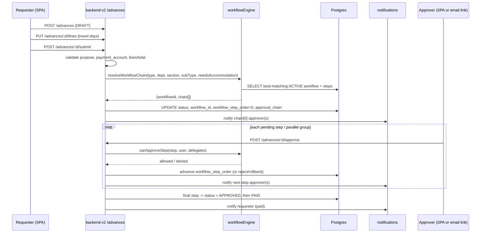
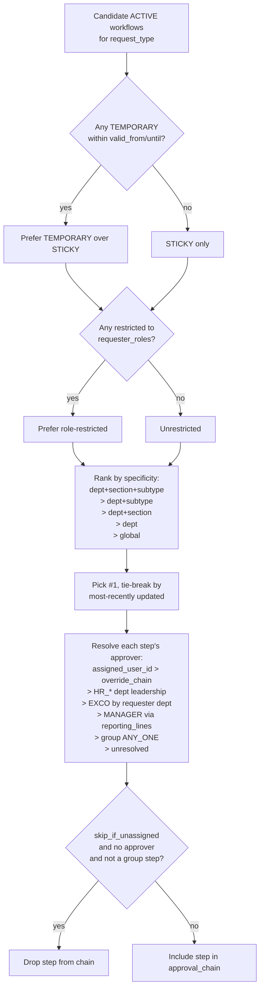
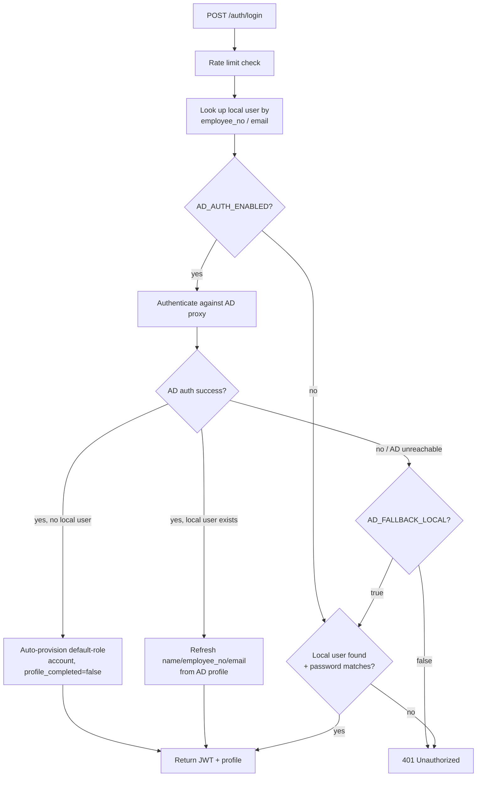
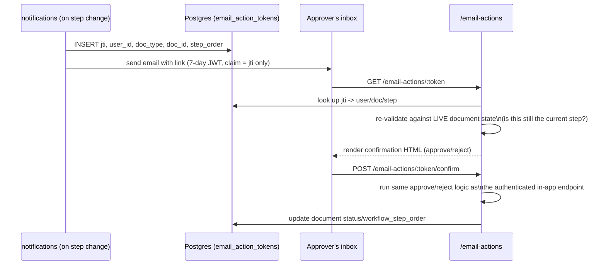

# Advance → Clearance System — Technical Specification

This document is the detailed companion to [`docs/ARCHITECTURE.md`](ARCHITECTURE.md)
(stack, module map, deployment). It covers **functional requirements**, the
**complete API contract**, the **full database schema**, and **process flow
diagrams**. All three detail sections were compiled by reading the actual
source (`backend-v2/src/modules/**`, `backend-v2/src/lib/workflowEngine.ts`,
`backend-v2/src/bootstrap/system.ts`, `db/schema.sql`) rather than inferred
from names — treat it as ground truth for how the system behaves today, not
aspirational design.

Role names referenced throughout (`ADMIN`, `MANAGER`, `FINANCE`, ...) are
per-endpoint authorization facts pulled directly from the route source, not
a claimed master list — the `role_type` Postgres enum carries some legacy
values no longer assigned to users, and `frontend/src/roles.ts`
(`ROLE_LABELS`) is the single source of truth for which roles are actually
in use. Check it directly rather than relying on any role list here staying
current.

## Contents

1. [Functional requirements](#1-functional-requirements)
2. [Process flow diagrams](#2-process-flow-diagrams)
3. [API contract](#3-api-contract)
4. [Data model reference](#4-data-model-reference)

---

# 1. Functional requirements

Requirement IDs are grouped by feature area and are not exhaustive of every
validation in the codebase — they capture the business rules that shape the
system's behavior.

### FR-AUTH — Authentication & authorization

- **FR-AUTH-1**: A user authenticates with `employee_no`, the local part of
  their email, or their full email, plus a password. Login is rate-limited
  (`loginLimiter`).
- **FR-AUTH-2**: When `AD_AUTH_ENABLED=true`, login is attempted against the
  internal Active Directory proxy first. A successful AD auth auto-provisions
  a local account (default role, `profile_completed=false`) on first login
  and refreshes `full_name`/`employee_no`/`email` from the AD profile on
  subsequent logins. If AD auth fails and `AD_FALLBACK_LOCAL=true`, the
  request falls through to local email+password verification; if
  `AD_FALLBACK_LOCAL=false`, the request is rejected outright.
- **FR-AUTH-3**: Local auth compares bcrypt password hashes and rejects
  inactive (`is_active=false`) users.
- **FR-AUTH-4**: A successful login returns a signed JWT plus the user's
  profile (role, department/division/section/team, permission groups,
  `profile_completed` flag).
- **FR-AUTH-5**: Every route except `/health`, `/auth/login`, and
  `/email-actions/*` requires a valid JWT (`requireAuth`). Many routes
  additionally gate on role (`requireRole`) or on a named feature flag plus
  a DB-configurable role allow-list (`requireFeatureAccess`) — see the API
  contract (§3) for the specific roles each endpoint currently allows.
- **FR-AUTH-6**: Role assignment is itself access-controlled: an `ADMIN`
  may assign any role; a `MANAGER`/`EXCO` may only assign roles to users
  within their own department.
- **FR-AUTH-7**: In production, the process refuses to start if
  `CORS_ORIGIN` is unset or if `ADMIN_SEED_PASSWORD` is left at its public
  default.

### FR-WF — Workflow engine (shared by Advances and Claims)

- **FR-WF-1**: An admin-defined `workflow` targets a `request_type`
  (`ADVANCE_REQUEST`, `CLAIM_REQUEST`, `OVERTIME_REQUEST`,
  `CLEARANCE_REQUEST`, plus `TRAVEL_REQUEST`, `ACCOMMODATION_REQUEST`,
  `PROCUREMENT_REQUEST`, `PETTY_CASH_REQUEST`, `CUSTOM_WORKFLOW`) and,
  optionally, a department, section, advance sub-type, and/or a
  `requester_roles` allow-list. Only `ACTIVE` workflows are eligible to
  resolve.
- **FR-WF-2**: When more than one workflow matches a request, the engine
  picks exactly one via a fixed priority order: (1) `TEMPORARY` workflows
  (bounded by `valid_from`/`valid_until`) outrank `STICKY` ones; (2) a
  workflow restricted to the requester's role outranks an unrestricted one;
  (3) within each tier, the most specific department+section+sub-type match
  wins, down to a fully generic (no department) workflow as the fallback.
  Ties break on most-recently-updated.
- **FR-WF-3**: Each `workflow_step` is scoped to a position
  (`position_type_code`, e.g. `MANAGER`, `HOD`, `EXCO`,
  `HR_MANAGER_REVIEW`/other `HR_*`, `FINANCE`, `CUSTOM`, ...) and resolves
  to an approver at chain-build time:
  - An explicitly `assigned_user_id` always wins.
  - A requester-chosen override (`override_chain`, travel advances only —
    see FR-ADV-4) replaces the approver for the step whose `action_type`
    matches the override's label (`Counter Signed By` → `COUNTER_SIGN`,
    `Approved By` → `APPROVE`).
  - An unassigned `HR_*` step routes to the Human Resource department's HOD
    (falling back to its manager).
  - An unassigned plain `EXCO` step (not an `ANY_ONE` group step) routes to
    the EXCO member whose own `department` matches the *requester's*
    department.
  - An unassigned plain `MANAGER` step (not an `ANY_ONE` group step) routes
    to the requester's manager per `reporting_lines`, falling back to
    department/section/team leadership when no active reporting-line row
    exists.
  - A step with `approval_mode = ANY_ONE` and an `approval_group_name` is a
    group step: any member of that permission group may act on it (see
    FR-WF-6); it is never treated as "unassigned."
  - Any other step with no resolvable approver and `skip_if_unassigned=true`
    is dropped from the chain entirely (unless it's a group step).
  - A step flagged `requires_accommodation=true` is included only when the
    request needs accommodation (travel advances with more than one line —
    see FR-ADV-2).
  - An `EMPLOYEE`-coded step represents the requester, not an approver, and
    is always excluded from the resolved chain.
- **FR-WF-4**: Consecutive steps flagged `parallel_with_previous` form a
  single "pending group" (`getPendingGroup`): they become actionable
  simultaneously and the chain advances only once every member of the group
  has approved.
- **FR-WF-5**: The resolved chain is frozen onto the request at submission
  time as `approval_chain` (jsonb) with `workflow_step_order = 0`; later
  changes to the Workflow Builder configuration do not retroactively affect
  an in-flight request (a rollback re-resolves it from scratch — FR-WF-8).
- **FR-WF-6**: `canApproveStep` authorizes an action if any of: the acting
  user is the step's `approver_id`; the acting user is a delegate acting on
  behalf of that approver (see FR-DEL-1); the step is an `ANY_ONE` group
  step and the user belongs to that permission group (users whose role is
  `HOD` or `MANAGER` are excluded from acting on
  `Team:`/`Section:`/`Department:`-prefixed org-unit groups, since they
  already have their own dedicated steps); or the step is unassigned
  `FINANCE` and the user's department is the Finance department.
- **FR-WF-7**: Approving the current pending group advances
  `workflow_step_order` past it. Reaching the final step (or the last group)
  sets the request to its terminal approved/settled state. A user with the
  `ADMIN` role can force-advance through any step without an approver
  check. A request with no `approval_chain` at all (created before the
  workflow engine, or a request type with no matching workflow) can only be
  advanced by that `ADMIN` role, via a legacy hardcoded status map.
- **FR-WF-8**: Rolling back a request clears `workflow_id`,
  `workflow_step_order`, and `approval_chain` and returns it to `DRAFT`; the
  chain is rebuilt from the current Workflow Builder configuration the next
  time it's submitted.
- **FR-WF-9**: Rejecting a request at any step sets it to a terminal
  rejected status; rejection is not reversible through the workflow itself.

### FR-ADV — Advances

- **FR-ADV-1**: Only the request's `created_by_id` may submit it, and only
  from `DRAFT`. Submission requires a non-empty `purpose` and
  `payment_account`.
- **FR-ADV-2**: For travel-type advances, submission requires at least one
  `advance_lines` row; the requested total is recomputed server-side from
  the lines (never trusted from the client) and must be greater than zero.
  More than one travel-line day implies an overnight stay, which flags the
  request as needing accommodation (feeding FR-WF-3's
  `requires_accommodation` step filter). Non-travel advances validate
  `requested_total > 0` directly.
- **FR-ADV-3**: `resolveWorkflowChain` is invoked at submission with the
  requester's department, section, advance sub-type, and accommodation
  need; if no workflow resolves, submission is rejected with a message
  directing the requester to contact an administrator.
- **FR-ADV-4**: A requester whose role is eligible (currently `CEO`, `EXCO`,
  or `MANAGER` — see `advances.routes.ts`) may supply an `override_chain`
  naming their own countersigner/approver, but only for travel-type
  advances, and only from a role-appropriate pool re-validated
  server-side: a `CEO`/`EXCO` requester may only pick an `EXCO` user; a
  `MANAGER` requester may pick an `EXCO` user or any user sharing their
  section or department.
- **FR-ADV-5**: Approving a request with an `approval_chain` routes through
  the workflow engine (FR-WF-6/7); approving one without a chain is
  restricted to the `ADMIN` role and follows a fixed legacy status ladder
  (`SUBMITTED → COUNTERSIGNED → HR_MANAGER_REVIEW → HR_OFFICER → APPROVED`,
  skipping `COUNTERSIGNED` if the department has no HOD).
- **FR-ADV-6**: Reaching the final approval step (typically Finance) both
  approves and marks the advance `PAID` in the same action, triggering a
  distinct "paid" notification in addition to the approval notification.
- **FR-ADV-7**: Advances in `APPROVED`, `PAID`, `REJECTED`, or `CANCELLED`
  cannot be approved again.
- **FR-ADV-8**: Advance recovery ("confirm not cleared") and the
  reconciliation/clearance-status reports are gated behind named feature
  flags (`requireFeatureAccess`), whose default role allow-list is defined
  per-endpoint in `advances.routes.ts` (see §3).

### FR-CLM — Clearance claims

- **FR-CLM-1**: A clearance claim reconciles a previously paid advance
  (actual spend vs. advance amount, via `claim_trips` and uploaded
  `receipts`) and is routed through the same generic workflow engine as
  advances (`request_type = CLAIM_REQUEST`), sharing FR-WF-1..9.
- **FR-CLM-2**: Receipts are uploaded per claim (`upload-receipt`) and can
  be individually deleted before submission; each claim exposes a generated
  PDF.
- **FR-CLM-3**: Settlement (`settle` / `mark-settled`) is restricted to
  the Finance role/department (`requireFinance`) and is the terminal step
  that closes out the reconciliation.

### FR-ACC — Accommodation requests

- **FR-ACC-1**: Accommodation requests reference an admin-maintained hotel
  list and a configurable per-night meal value (`meal-value`), both
  editable only by the roles listed for those routes in `accommodation.routes.ts`
  (see §3).
- **FR-ACC-2**: A request collects one or more hotel quotations
  (`upload-quotation`) before being forwarded to Finance
  (`send-to-finance`), which is a simpler, single-stage flow distinct from
  the multi-step Workflow Builder chain used by advances/claims.
- **FR-ACC-3**: Marking paid or rejecting an accommodation request is
  restricted to the Finance role/department (`requireFinance`).

### FR-OT — Overtime

- **FR-OT-1**: Overtime has two related but separately tracked documents:
  `overtime_requests` (pre-authorization to work overtime) and
  `overtime_claims` (payment claim for overtime actually worked), each with
  its own approval endpoints.
- **FR-OT-2**: Overtime requests use a fixed three-stage approval sequence —
  `approve-supervisor` → `approve-hod` → `approve-cto` — rather than the
  configurable Workflow Builder chain used by advances/claims; any stage can
  independently `reject`.
- **FR-OT-3**: Overtime claims flow through `authorise` → `hr-note` →
  `finance-verify` → `record-earnings`, with a separate `transfer-summary`
  endpoint, again as a fixed sequence rather than a configurable chain.
- **FR-OT-4**: Creating either an overtime request or claim is gated by the
  `overtime_request`/`overtime_claim` feature flags (see §3 for their
  default role allow-lists).

### FR-ATT — Attendance

- **FR-ATT-1**: Attendance records (intern/temporary staff only) are
  created and updated directly (`POST`/`PUT /attendance`) with no
  multi-step approval chain — the simplest of the request types.

### FR-CUST — Custom / ad-hoc requests

- **FR-CUST-1**: Custom request types are defined dynamically (via the
  `request-types` module's field catalog) rather than hardcoded — each
  submission carries a `data` object keyed by admin-configured
  `field_key`s, one of whose field types (`user_multi`) holds the list of
  assignees.
- **FR-CUST-2**: An assignee entry is either a specific person (`id`/`email`
  set) or an entire team (`teamId` set, no individual `id`) — a team entry
  is satisfiable by confirmation from any one member of that team
  (`assignees/confirm`), not a fixed named approver.
- **FR-CUST-3**: Only a user who already appears as an assignee on the
  submission (directly, or via team membership) may add further assignees
  or act on the request — `isSubmissionAssignee` gates those endpoints.
- **FR-CUST-4**: A custom request can be cancelled by its owner
  (`/cancel`) or closed out (`/close`) independent of the assignee
  confirmation flow.

### FR-DED — Deductions

- **FR-DED-1**: Deduction records are read-only except for a single
  `PATCH /:id/deducted` action toggling whether a deduction has been
  applied to payroll; access is gated by `deductionsPermissions.ts`
  (`/deductions/access`), which resolves against admin-configured
  permission groups rather than a fixed role list.

### FR-DEL — Delegation

- **FR-DEL-1**: A user may delegate their approval authority for specific
  request types to another user for a bounded period; `canApproveStep`
  (FR-WF-6) honors an active delegate acting on behalf of any approver who
  has delegated to them, regardless of the delegator's position type in the
  chain — delegation eligibility itself is enforced when the delegation is
  created, not re-checked per step.

### FR-NOTIFY — Notifications

- **FR-NOTIFY-1**: Every workflow-relevant state change (submit, each
  approval, reject, rollback, mark-paid) triggers an email notification to
  the requester and/or the next approver(s), addressed to every member of a
  parallel pending group (FR-WF-4) individually.
- **FR-NOTIFY-2**: Email delivery prefers the internal AD-backed HTTP email
  API (`EMAIL_API_ENABLED`) and falls back to SMTP (`SMTP_ENABLED`) only
  when the API transport is disabled. Microsoft Teams webhook notifications
  are a separate, independently toggled channel (`TEAMS_ENABLED`).
- **FR-NOTIFY-3**: Approval notifications embed a one-click action link
  (see FR-EMAIL-1) so an approver can act without logging into the SPA.

### FR-EMAIL — Email-action (approve/reject by email)

- **FR-EMAIL-1**: A notification email's action link carries a JWT
  (7-day expiry, `purpose=EMAIL_ACTION`) whose only claim is a `jti`; every
  binding fact (which user, which document, which step) is looked up
  server-side from an `email_action_tokens` row keyed by that `jti`, so a
  token's authority is re-validated against *live* document state on click
  rather than trusted from the token's own claims (e.g. a token minted for
  step 2 is meaningless once the document has moved to step 3).
- **FR-EMAIL-2**: `GET /email-actions/:token` renders a self-contained
  confirmation HTML page (no SPA/asset dependency); `POST
  /email-actions/:token/confirm` executes the bound approve/reject action
  and shares the exact same `performAdvanceApprove`/`performClaimApprove`/
  `performCustomRequestAction` functions as the authenticated in-app
  endpoints — email approvals go through identical business logic to the
  in-app buttons.
- **FR-EMAIL-3**: The public entry point for these links can be isolated to
  a single restricted reverse-proxy path (`EMAIL_ACTION_PUBLIC_URL`)
  exposing *only* `/email-actions/*`, so approvers off the internal network
  can act without the rest of the app being publicly reachable.

### FR-PDF — PDF generation & templates

- **FR-PDF-1**: Every request type (advances, claims, accommodation,
  overtime, custom requests) exposes a `GET /:id/pdf` endpoint rendering a
  document via `pdfkit`.
- **FR-PDF-2**: Document layout (letterhead, field placement) is
  admin-configurable through the `pdf-templates` module rather than
  hardcoded per document type, and access to a given PDF is gated by
  `canAccessPdf` against admin-configured per-template permissions rather
  than a fixed role list.

### FR-ORG — Organizational structure

- **FR-ORG-1**: Org structure is Division → Department → Section → Team.
  Departments and sections each link to one or more divisions (many-to-many,
  via `department_division_links`/`section_division_links`); a user carries
  `division_id`/`section_id`/`team_id` plus a legacy free-text `department`
  column still used by some older reporting/filtering paths. Each level has
  an optional leadership user (`manager_user_id`/`hod_user_id`/
  `exco_user_id`/`leader_user_id`), used throughout FR-WF-3's
  step-resolution fallbacks.
- **FR-ORG-2**: `reporting_lines` is a separate, explicit employee→manager
  hierarchy (with effective-dated rows) that takes priority over
  department/section/team leadership when resolving an unassigned
  `MANAGER` step (FR-WF-3) — it can express reporting relationships that
  don't follow the formal org chart.
- **FR-ORG-3**: `position_vacancies` tracks unfilled leadership seats so an
  admin can either promote an existing user or onboard a new one directly
  into the vacancy (`POST /auth/position-vacancies/:id/fill`).

---

# 2. Process flow diagrams

### Advance request lifecycle (submit → workflow approval → payment)



### Workflow chain resolution priority (`resolveWorkflowChain`)



### Auth: login (local + Active Directory)



### Approve/Reject by email (no login required)



---

# 3. API contract

Mount order from `backend-v2/src/app.ts` (all prefixes are appended to whatever base URL the API is served on):

```
/health, /auth, /advances, /accommodation-requests & /accommodation (same router),
/claims (claims-sla.routes mounted first, then claims.routes),
/inbox, /attendance, /overtime, /travel, /workflows, /reporting-lines,
/request-types, /custom-requests, /email-actions, /pdf-templates, /deductions, /ai
```

Global middleware: `helmet`, `compression`, `cors`, `express.json({limit:"2mb"})`, request logger, and a `Cache-Control` short-cache (60s) applied to GETs under `/travel`, `/workflows`, `/request-types`, `/auth/departments`, `/auth/directory`. Every router except `health` and `email-actions` calls `requireAuth` (JWT bearer) at the top; additional role/feature gates are noted per-route, sourced directly from each route's guard in code. `requireRole([...])` = hard role allow‑list (403 otherwise). `requireFeatureAccess(key, defaultRoles)` = DB-configurable allow‑list (`admin_feature_permissions` table, seeded from `FEATURE_DEFAULTS`), the `ADMIN` role always included. Role names in the tables below are the literal values read from each route file, not a curated list — see `frontend/src/roles.ts` for which are currently in active use.

## health (`/health`)

| Method & Path | Auth | Body/Query | Response | Purpose |
|---|---|---|---|---|
| GET `/health` | none (public) | – | `{ ok: true }` | Liveness check |

## auth (`/auth`)

| Method & Path | Auth | Body/Query/Params | Response | Purpose |
|---|---|---|---|---|
| POST `/auth/login` | public, rate-limited (`loginLimiter`) | `{ email? \| userName?, password }` (zod `LoginSchema`, one of email/userName required) | `{ token, user:{id,role,full_name,employee_no,department,division_id,section_id,team_id,employment_type,profile_completed} }` | Local or AD login; auto-provisions AD users |
| — `authRouter.use(requireAuth)` applies to everything below — |
| GET `/auth/me` | auth | – | Full user profile row + `division_name/section_name/team_name`, `groups[]`, `favorite_pages` | Current user profile |
| PATCH `/auth/me/favorites` | auth | `{ favorite_pages: string[] (max 20) }` | `{ favorite_pages }` | Replace dashboard shortcuts |
| POST `/auth/verify-password` | auth | `{ password }` | `{ verified: true }` or 401 | Re-verify current user's password (AD-aware) |
| GET `/auth/departments` \| `/auth/groups` | auth | – | array of department/group records | List "division" groups |
| POST `/auth/departments` \| `/auth/groups` | requireRole([ADMIN]) | `CreateDepartmentSchema`: `name, section_id?, division_id?, hod_user_id?, manager_user_id?, exco_user_id?, active?, is_business_partner?, division_ids?[]` | created group | Create division group |
| PUT `/auth/departments/:department` \| `/auth/groups/:department` | requireRole([ADMIN]) | `UpdateDepartmentSchema` (same shape) | updated group | Update division group |
| DELETE `/auth/departments/:department` \| `/auth/groups/:department` | requireRole([ADMIN]) | – | `{ ok }`/result | Delete division group |
| GET `/auth/sections` | auth | – | array | List section groups |
| POST `/auth/sections` | requireRole([ADMIN]) | `CreateSectionSchema`: `name, department_id?, exco_user_id?, is_business_partner?, division_ids?` | created section (201) | Create section |
| PUT `/auth/sections/:id` | requireRole([ADMIN]) | `UpdateSectionSchema` | updated section | Update section |
| PUT `/auth/sections/:id/owner` | requireRole([ADMIN]) | `{ role: "HOD"\|"MANAGER", user_id: uuid\|null }` | updated section | Assign section HOD/Manager |
| DELETE `/auth/sections/:id` | requireRole([ADMIN]) | – | result | Delete section |
| GET `/auth/departments-with-sections` | auth | – | tree | Divisions/departments/sections tree |
| GET `/auth/leadership-users` | requireRole([ADMIN, MANAGER, EXCO]) | – | array | Eligible leadership pickers |
| GET `/auth/divisions` | auth | – | array | List divisions (companies) |
| POST `/auth/divisions` | requireRole([ADMIN]) | `{ name, description? }` | created (201) | Create division |
| PUT `/auth/divisions/:id` | requireRole([ADMIN]) | `{ name, description?, active? }` | updated | Update division |
| DELETE `/auth/divisions/:id` | requireRole([ADMIN]) | – | result | Delete division |
| GET `/auth/teams` | auth | `?section_id` | array | List teams (optionally by section) |
| POST `/auth/teams` | requireRole([ADMIN]) | `{ name, section_id?, leader_user_id? }` | created (201) | Create team |
| PUT `/auth/teams/:id` | requireRole([ADMIN]) | `{ name, section_id?, leader_user_id?, active? }` | updated | Update team |
| DELETE `/auth/teams/:id` | requireRole([ADMIN]) | – | result | Delete team |
| GET `/auth/org-structure` | auth | – | tree | Full org tree (division→section→team) |
| DELETE `/auth/org-structure/unassigned` | requireRole([ADMIN]) | – | `{ deleted:{...}, skipped:{...} }` | Bulk-delete unassigned nodes |
| GET `/auth/ceo` | auth | – | array of CEO user rows | List CEO account(s) |
| POST `/auth/admin/clear-sessions` | requireRole([ADMIN]) | – | `{ ok:true }` | Force-logout everyone (bumps `sessions_cleared_at`) |
| POST `/auth/admin/reset-profiles` | requireRole([ADMIN]) | – | `{ ok:true }` | Reset all non-admin profiles + clear sessions |
| POST `/auth/complete-profile` | auth | `ProfileSchema`: `full_name, department, division_id?, section_id?, team_id?, employment_type="PERMANENT", employee_no?` (required if PERMANENT) | auth response (token+user) | Requester completes their own profile |
| GET `/auth/users` | auth + `requireUserManagementAccess` (ADMIN or feature-permission `user_management`) | `?division_id` | array of users w/ org names, groups | List users |
| GET `/auth/request-directory` | auth | `?scope=company` (else dept-scoped) | array of `{id,full_name,email,employee_no,title,department,employment_type,role,profile_completed}` | Directory for approver/assignee pickers |
| POST `/auth/users/:id/department` \| `/auth/users/:id/group` | requireRole([ADMIN]) | `UpdateUserDepartmentSchema`: `department, division_id?, section_id?, team_id?` | updated user | Reassign a user's division/section/team |
| GET `/auth/delegations/eligibility` | auth | – | `{ eligible: boolean }` | Whether caller can be a delegate (workflow step assignment) |
| GET `/auth/delegations` | auth | – | array (ADMIN sees all, else own as manager) | List manager delegations |
| POST `/auth/delegations` | auth | `CreateDelegationSchema`: `manager_id?(ADMIN only), delegate_id, from_date?, to_date?, reason?, comments?, request_types?[]` | created delegation (201) | Create a delegation |
| POST `/auth/delegations/:id/end` | auth (must be own delegation or ADMIN) | `{ reason? }` | updated delegation | End a delegation |
| GET `/auth/delegations/:id/audit` | auth | – | array of audit rows | Delegation audit trail |
| POST `/auth/users/:id/role` | requireRole([ADMIN, MANAGER, EXCO]) | `UpdateUserRoleSchema`: `{ role, is_active? }` | updated user | Change a user's role |
| GET `/auth/position-vacancies` | auth | `?role` | array | List open leadership vacancies |
| POST `/auth/position-vacancies` | requireRole([ADMIN]) | `CreatePositionVacancySchema`: `role, title?, department?, division_id?, section_id?, team_id?, notes?` | created (201) | Create a vacancy |
| DELETE `/auth/position-vacancies/:id` | requireRole([ADMIN]) | – | `{ ok }` | Delete an unfilled vacancy |
| POST `/auth/position-vacancies/:id/fill` | requireRole([ADMIN, MANAGER, EXCO]) | `FillPositionVacancySchema`: `existing_user_id?` OR `email, full_name?, employee_no?, title?, employment_type?` | `{ ok, user_id }` | Fill a vacancy (promote existing or create new) |
| POST `/auth/users` | requireRole([ADMIN]) | `CreateUserSchema`: `email, full_name?, employee_no?, title?, department?, section?, division_id?, section_id?, team_id?, manager_type_id?, employment_type?, role?, is_active?, groups?[]` | created user (201) | Admin onboards a user |
| PUT `/auth/users/:id` | requireRole([ADMIN, MANAGER, EXCO]) | `UpdateUserSchema` (partial of create fields) | updated user + `groups` | Update user attributes |
| DELETE `/auth/users/:id` | requireRole([ADMIN]) | – | `{ ok }` | Soft-delete (deactivate) user |
| DELETE `/auth/users/:id/permanent` | requireRole([ADMIN]) | – | `{ ok }` (400 if blocking financial/audit records exist) | Hard-delete a user |
| GET `/auth/manager-types` | auth | – | array | List manager types |
| POST `/auth/manager-types` | requireRole([ADMIN]) | `{ name, role: "MANAGER"\|"HOD", description? }` | created (201) | Create manager type |
| PUT `/auth/manager-types/:id` | requireRole([ADMIN]) | same shape + `active?` | updated | Update manager type |
| DELETE `/auth/manager-types/:id` | requireRole([ADMIN]) | – | `{ ok }` | Delete manager type |
| POST `/auth/departments/:department/role` | requireRole([ADMIN, MANAGER, EXCO]) | `UpdateUserRoleSchema` | `{ ok, updated_count, department, role }` | Bulk role change for everyone in a division |
| GET `/auth/employment-types` | auth | – | array | List employment types |
| POST `/auth/employment-types` | requireRole([ADMIN]) | `{ code, name, active?, sort_order? }` | `{ id, code }` (201) | Upsert employment type |
| PUT `/auth/employment-types/:id` | requireRole([ADMIN]) | partial of above | `{ ok }` | Update employment type |
| DELETE `/auth/employment-types/:id` | requireRole([ADMIN]) | – | `{ ok }` | Delete employment type |
| GET `/auth/admin-feature-permissions` | auth | – | `{ features: Record<key,string[]> }` | Feature-flag → allowed-roles map |
| PUT `/auth/admin-feature-permissions` | requireRole([ADMIN]) | `{ features: Record<key,string[]> }` | `{ ok }` | Update feature permissions (ADMIN always retained) |
| GET `/auth/permission-groups` | auth | – | array | List custom permission groups |
| POST `/auth/permission-groups` | requireRole([ADMIN]) | `{ name }` | array (updated list, 201) | Create permission group |
| DELETE `/auth/permission-groups/:name` | requireRole([ADMIN]) | – | array | Delete permission group ("ADMIN" protected) |
| PUT `/auth/permission-groups/:name/visibility` | requireRole([ADMIN]) | `{ hidden: boolean }` | array | Toggle group visibility |
| GET `/auth/permission-groups/:name/members` | requireRole([ADMIN]) | – | array | List group members |
| POST `/auth/permission-groups/:name/members` | requireRole([ADMIN]) | `{ user_id: uuid }` | array (201) | Add member (rejects org-derived groups) |
| DELETE `/auth/permission-groups/:name/members/:userId` | requireRole([ADMIN]) | – | array | Remove member |
| GET `/auth/session-settings` | auth | – | `{ idle_timeout_minutes, warning_seconds }` | Idle-session config |
| PUT `/auth/session-settings` | requireRole([ADMIN]) | `{ idle_timeout_minutes(1-1440), warning_seconds(10-600) }` | `{ ok }` | Update idle-session config |
| POST `/auth/tour-progress` | auth | `{ tour_key, step_index, total_steps, completed? }` | 204 No Content | Track onboarding tour progress |
| GET `/auth/tour-progress/report` | requireRole([ADMIN]) | – | array | All users' tour progress |

## advances (`/advances`)

Auth: `requireAuth` router-wide. Role/feature gates noted per row, sourced from `advances.routes.ts`. `requireAdvanceActionAccess` = MANAGER/HOD/EXCO/ADMIN or Finance-dept (per that guard's current implementation).

| Method & Path | Auth | Body/Query/Params | Response | Purpose |
|---|---|---|---|---|
| GET `/advances/sla-report` | auth | `?period_days` | `{ sla_targets, summary, avg_metrics, by_department, by_type, requests[] }` | Advance SLA analytics |
| GET `/advances/recovery-settings` | feature `advance_recovery_settings` (default roles ADMIN,FINANCE) | – | `{ clearance_duration_days, recovery_months, updated_at }` | Read recovery policy |
| PUT `/advances/recovery-settings` | feature `advance_recovery_settings` | `{ clearance_duration_days:int≥1, recovery_months:int≥1 }` | `{ ok }` | Update recovery policy |
| POST `/advances/:id/confirm-not-cleared` | feature `advance_recovery_settings` | – | `{ ok, recovery_deduction_amount, recovery_months }` | Mark an overdue paid advance as never-cleared, compute monthly deduction |
| GET `/advances/reconciliation-report` | feature `report_reconciliation` (default roles ADMIN,FINANCE) | `?from,?to` (YYYY-MM-DD) | `{ from, to, rows[] }` | Finance opening/closing balance report |
| GET `/advances/clearance-status-report` | feature `clearance_status_report` (default roles set in `CLEARANCE_STATUS_REPORT_DEFAULT_ROLES`) | – | `{ items[] }` (COMPLETE/NOT_COMPLETE/NOT_CLEARED classification) | Clearance status report (HR/Finance) |
| GET `/advances/` | auth | `?mine=true` | array of advances (own or, non-mine, ADMIN-only all) | List advances |
| GET `/advances/payments/access` | auth | – | `{ allowed: boolean }` | Nav-gate check for Payments |
| GET `/advances/payments` | feature `payments` (default roles ADMIN, Dept:Finance) | `?status=pending\|paid\|all, limit, offset` | `{ items[], total, limit, offset }` | Payments queue (advances pending/paid) |
| GET `/advances/:id` | auth (view-access checked) | – | advance row + `lines[]`, `accommodation_requests[]` | Advance detail |
| GET `/advances/:id/history` | owner/creator/ADMIN | – | array of audit rows | Advance audit trail |
| GET `/advances/:id/pdf` | view+PDF access | – | `application/pdf` stream | Advance PDF (template or fallback renderer) |
| POST `/advances/` | auth | `CreateAdvanceSchema`: `type, purpose, project_number?, payment_method="ECOCASH"\|"BANK", payment_account?/ecocash_number?/bank_*, requested_total≥0, beneficiary_user_id?, override_chain?[]` | `{ id }` (201) | Create draft advance |
| PUT `/advances/:id` | creator only, status DRAFT/SUBMITTED | `UpdateAdvanceSchema` (all optional versions of create fields) | `{ ok }` | Edit draft advance |
| PUT `/advances/:id/lines` | creator only, status DRAFT/SUBMITTED | `LinesSchema`: `{ lines:[{line_date, location?, travel_meta?, meals_count?, meal_value?, breakfast?, lunch?, dinner?}] }` | `{ ok, requested_total, meal_value }` | Replace travel table lines |
| POST `/advances/:id/submit` | creator only | – | `{ ok, status }` | Submit for approval (resolves workflow chain) |
| POST `/advances/:id/rollback` | `requireAdvanceActionAccess` | `{ comments (required) }` | `{ ok, status:"DRAFT" }` | Send back to draft |
| POST `/advances/:id/reject` | `requireAdvanceActionAccess` | `{ comments (required) }` | `{ ok, status:"REJECTED" }` | Reject advance |
| POST `/advances/:id/approve` | auth (workflow-step gated internally) | `{ approved_total: number>0 }` | `{ ok, status }` | Approve current workflow step |
| POST `/advances/:id/mark-paid` | Finance dept/ADMIN or named MARK_PAID step approver | `{}` | `{ ok, status }` | Mark advance (and linked accommodation) paid, generates payment reference |
| POST `/advances/:id/revoke` | creator only | – | `{ ok, status }` | Cancel/revoke own advance |
| POST `/advances/:id/remind` | requester/creator/ADMIN | – | `{ ok, approverName }` | Nudge current pending approver via email |

## accommodation (`/accommodation-requests` and `/accommodation` — same router mounted twice)

Auth: `requireAuth` router-wide. Roles sourced from `accommodation.routes.ts`.

| Method & Path | Auth | Body/Query/Params | Response | Purpose |
|---|---|---|---|---|
| GET `/accommodation/hotels` | auth | – | array | List hotels |
| POST `/accommodation/hotels` | requireRole([HR_MANAGER, MANAGER, ADMIN]) | `HotelCreateSchema`: `name, district?/country?+city?(one required), province?(required if country=South Africa), address?, contact?` | `{ id }` (201) | Create hotel |
| PUT `/accommodation/hotels/:id` | requireRole([HR_MANAGER, MANAGER, ADMIN]) | `HotelUpdateSchema` (partial) | `{ ok }` | Update hotel |
| DELETE `/accommodation/hotels/:id` | requireRole([HR_MANAGER, MANAGER, ADMIN]) | – | `{ ok }` | Delete hotel |
| GET `/accommodation/meal-value` | auth | – | `{ meal_value }` | Read global meal-value system setting |
| PUT `/accommodation/meal-value` | requireRole([HR_MANAGER, MANAGER, ADMIN]) | `{ meal_value≥0 }` | `{ meal_value }` | Update global meal value |
| GET `/accommodation/` | auth | `?mine=true` | array (ADMIN/Finance see all, else own bookings) | List accommodation requests |
| POST `/accommodation/` | auth (must be current workflow approver on linked advance, or ADMIN) | `CreateAccommodationSchema`: `advance_request_id, location, provider?, check_in?, check_out?, amount>0, notes?` | `{ id, status:"DRAFT" }` (201) | Create accommodation booking (linked to a travel advance) |
| POST `/accommodation/:id/upload-quotation` | creator or ADMIN, status DRAFT | multipart `file` (pdf/jpg/jpeg/png/doc/docx, ≤25MB) | `{ ok, quotation_path }` | Attach a hotel quotation |
| POST `/accommodation/:id/send-to-finance` | creator or ADMIN, status DRAFT | – | `{ ok, status:"SUBMITTED", advance_status }` | Submit to Finance & advance the linked advance's workflow step |
| GET `/accommodation/:id` | ADMIN/Finance/creator/requester | – | row + `quotations[]`, `can_view_pdf` | Accommodation detail |
| GET `/accommodation/:id/pdf` | same as above + PDF permission | – | `application/pdf` | Accommodation PDF |
| POST `/accommodation/:id/mark-paid` | `requireFinance` | – | `{ ok, status:"PAID", paid_reference }` | Mark accommodation paid |
| POST `/accommodation/:id/reject` | `requireFinance` | `{ comments (required) }` | `{ ok, status:"REJECTED" }` | Reject accommodation booking |

## claims-sla (`/claims`, mounted before claims.routes)

Auth: `requireAuth`; all routes gated by `requireFeatureAccess("claims_sla_report", [ADMIN, FINANCE, HR_MANAGER])` (default roles as configured in the route).

| Method & Path | Auth | Body/Query | Response | Purpose |
|---|---|---|---|---|
| GET `/claims/sla-thresholds` | feature `claims_sla_report` | – | array `{id, position_type_code, sla_days}` | Read SLA-day thresholds per workflow step type |
| PUT `/claims/sla-thresholds` | feature `claims_sla_report` | `{ thresholds:[{position_type_code, sla_days:int≥0}] }` (must include a `"*"` default) | `{ ok }` | Replace SLA thresholds |
| GET `/claims/sla-report` | feature `claims_sla_report` | `?period_days` | `{ thresholds, summary, by_approver[], late_approvals[] }` | Per-approver clearance SLA analytics |

## claims (`/claims`)

Auth: `requireAuth` router-wide.

| Method & Path | Auth | Body/Query/Params | Response | Purpose |
|---|---|---|---|---|
| GET `/claims/` | auth | `?mine=true` | array (own, or ADMIN-only all) | List clearance claims |
| POST `/claims/` | auth (`assertUserCanRequest`) | `{ month?, duty_station?, project_number?, vehicle_reg?, vehicle_type?, engine_cc?, vehicle_rate?, linked_advance_id?, settlement_method_requested?, settlement_ecocash_number?, settlement_bank_*?, reason_for_overspend? }` | `{ id }` (201) | Create draft clearance claim (auto-syncs trips from linked advance) |
| GET `/claims/:id` | view-access checked (`canViewClaim`) | – | claim + `trips[]`, `receipts[]` (with `size_bytes`), `can_view_pdf` | Claim detail |
| GET `/claims/:id/receipts/:receiptId/file` | view-access checked | `?download=1` | binary file stream | Download/view a receipt |
| GET `/claims/:id/pdf` | view + PDF access | – | `application/pdf` | Claim PDF |
| PUT `/claims/:id` | claimant only, status DRAFT | same fields as POST | `{ ok, advance_amount, balance_amount }` | Edit draft claim |
| PUT `/claims/:id/trips` | claimant only, status DRAFT | `{ trips:[{trip_date, from_place?, to_place?, depart_time?, arrive_time?, km_travelled, petrol_allowance, breakfast, lunch, dinner, other_expenses, purpose?}] }` | `{ ok, claim_total, balance_amount }` | Replace claim trip lines |
| POST `/claims/:id/upload-receipt` | claimant only, status DRAFT | multipart `file` (pdf/jpg/jpeg/png,≤25MB) + `category?,amount?,notes?` | `{ ok, receipt }` | Upload a receipt |
| DELETE `/claims/:id/receipts/:receiptId` | claimant only, status DRAFT | – | `{ ok }` | Remove a receipt |
| POST `/claims/:id/submit` | claimant only, status DRAFT | – | `{ ok, status }` | Submit claim (resolves workflow chain) |
| POST `/claims/:id/approve` | auth (workflow-step gated) | – | `{ ok, status }` | Approve current workflow step |
| POST `/claims/:id/reject` | auth (workflow-step gated) | `{ comments: min1 }` | `{ ok, status:"REJECTED" }` | Reject claim |
| POST `/claims/:id/rollback` | auth (workflow-step gated, or Finance if status FINANCE_VERIFIED) | `{ comments: min1 }` | `{ ok, status:"DRAFT" }` | Roll back to draft |
| POST `/claims/:id/settle` | `requireFinance` | `FinanceDecisionSchema`: `finance_decision:"ACCEPTED"\|"REFUND_FROM_EMPLOYEE"\|"REIMBURSE_EMPLOYEE", finance_comments, settlement_amount?, settled_method?, settled_reference?, assignee_user_id?, assignee_group_name?, expected_payment_date?` | `{ ok, status }` | Record Finance's settlement decision |
| POST `/claims/:id/mark-settled` | `requireFinance` | `{ settled_method?, settled_reference? }` | `{ ok, status }` | Confirm settlement payment made, closes claim |

## inbox (`/inbox`)

Auth: `requireAuth` router-wide. No write endpoints — purely aggregated read views driven by role-based rules (`allowedInboxForRole`) plus workflow-chain participation.

| Method & Path | Auth | Query | Response | Purpose |
|---|---|---|---|---|
| GET `/inbox/my-actions` | auth | `?limit` (1-200, default 50) | `{ items:[{id, action, doc_type, entity_id, current_status, requester_name, created_at}] }` | Recent actions the caller personally took (audit-log based) |
| GET `/inbox/` | auth | – | `{ items:[...] }` — mixed `doc_type` of `ADVANCE`,`CLAIM`,`ACCOMMODATION`,`OVERTIME_REQUEST`,`OVERTIME_CLAIM`,`CUSTOM_REQUEST`, each with status, amounts, `current_step_*` metadata, `is_delegated`, `delegated_from_manager_name` | Unified approval/task inbox for the current user (role rules + workflow-chain participation + delegation-aware) |

## attendance (`/attendance`)

Auth: `requireAuth` router-wide. (Records are for intern/temporary staff only.)

| Method & Path | Auth | Body/Query/Params | Response | Purpose |
|---|---|---|---|---|
| GET `/attendance/` | auth | `?mine` (default true) | array (own+compiled-by, or all) | List attendance registers |
| GET `/attendance/:id` | owner/compiler/ADMIN | – | row | Attendance detail |
| POST `/attendance/` | auth (`ensureAttendancePermissions`: self or same-division delegate) | `AttendanceSchema`: `employee_id, division?, section_name?, month(1-12), year(2000-2100), account_project_no?, day_codes:[{day,code}](max31), checked_by?, checked_date?, approved_by?, approved_date?, status="DRAFT"\|"SUBMITTED"` | `{ id }` (201) | Create/upsert monthly attendance register (unique on employee/month/year) |
| PUT `/attendance/:id` | compiler/ADMIN | same as POST | `{ ok }` | Update attendance register |

## overtime (`/overtime`)

Auth: `requireAuth` router-wide. Roles sourced from `overtime.routes.ts`.

| Method & Path | Auth | Body/Query/Params | Response | Purpose |
|---|---|---|---|---|
| GET `/overtime/requests` | auth | – | array (own+created, or all if ADMIN) | List overtime requests |
| GET `/overtime/requests/:id` | owner/ADMIN | – | row + `can_view_pdf` | Request detail |
| GET `/overtime/requests/:id/pdf` | owner/ADMIN + PDF perm | – | `application/pdf` | Request PDF |
| POST `/overtime/requests` | feature `overtime_request` (default roles as configured in the route) | `OvertimeRequestSchema`: `employee_id?, employee_name?, employee_no?, job_title?, section_name?, year, month, remarks?, recommended_by_supervisor?, supervisor_date?, approved_by_hod?, approved_by_cto?, lines:[{date,day?,estimated_start?,estimated_end?,actual_start?,actual_end?,reason?,noc?,car_reg?}], status` | `{ id }` (201) | Create overtime request |
| PUT `/overtime/requests/:id` | creator/ADMIN | same as POST | `{ ok }` | Update overtime request |
| GET `/overtime/claims` | auth | – | array | List overtime claims |
| GET `/overtime/claims/:id` | owner/ADMIN | – | row + `can_view_pdf` | Claim detail |
| GET `/overtime/claims/:id/pdf` | owner/ADMIN + PDF perm | – | `application/pdf` | Claim PDF |
| POST `/overtime/claims` | feature `overtime_claim` | `OvertimeClaimSchema`: `overtime_request_id?, employee_id?, ..., year, month, lines:[{date?,day?,from_time?,to_time?,ordered_by?,hours_125,hours_150,hours_200,converted_hours,account_or_project?,activity_name?}], total_overtime, compensated_hours, pay_days, authorised_by?, ..., hourly_rate, total_amount, status` | `{ id }` (201) | Create overtime claim |
| PUT `/overtime/claims/:id` | creator/ADMIN | same as POST | `{ ok }` | Update overtime claim |
| POST `/overtime/requests/:id/approve-supervisor` | requireRole([MANAGER, ADMIN]) | – | `{ ok, status:"SUPERVISOR_APPROVED" }` | Supervisor recommends request |
| POST `/overtime/requests/:id/approve-hod` | requireRole([MANAGER, HOD, ADMIN]) | – | `{ ok, status:"HOD_APPROVED" }` | HOD approves |
| POST `/overtime/requests/:id/approve-cto` | requireRole([ADMIN, EXCO]) | – | `{ ok, status:"APPROVED" }` | Final (CTO/EXCO) approval |
| POST `/overtime/requests/:id/reject` | requireRole([MANAGER, HOD, ADMIN, EXCO]) | `{ reason? }` | `{ ok, status:"REJECTED" }` | Reject overtime request |
| POST `/overtime/claims/:id/authorise` | requireRole([MANAGER, ADMIN]) | – | `{ ok, status:"MANAGER_AUTHORISED" }` | Manager authorises claim |
| POST `/overtime/claims/:id/hr-note` | requireRole([HR_MANAGER, ADMIN]) | `{ notation_hr?, hourly_rate?, salary_class?, number_of_hours? }` | `{ ok, status:"HR_NOTED" }` | HR notes/rates claim |
| POST `/overtime/claims/:id/finance-verify` | ADMIN or Finance dept | `{ calculated_by? }` | `{ ok, status:"FINANCE_VERIFIED" }` | Finance verifies |
| POST `/overtime/claims/:id/record-earnings` | requireRole([HR_MANAGER, ADMIN]) | `{ checked_noted_earning_by? }` | `{ ok, status:"EARNINGS_RECORDED" }` | HR records earnings |
| POST `/overtime/claims/:id/transfer-summary` | requireRole([HR_MANAGER, ADMIN]) | `{ transferred_to_summary_by? }` | `{ ok, status:"SUMMARY_TRANSFERRED" }` | HR transfers to payroll summary |

## travel (`/travel`)

Auth: `requireAuth` router-wide. Roles sourced from `travel.routes.ts`.

| Method & Path | Auth | Body/Query/Params | Response | Purpose |
|---|---|---|---|---|
| GET `/travel/types` | auth | – | array (inactive included for HR_MANAGER/MANAGER/ADMIN) | List travel advance types |
| POST `/travel/types` | requireRole([HR_MANAGER, MANAGER, ADMIN]) | `TravelTypeSchema`: `code?, name, location_mode:"DISTRICT"\|"COUNTRY_CITY", rate_kind:"MEAL"\|"DAILY", rate_general_staff, rate_exco, rate_ceo, currency, active?, requires_accommodation?, allowed_payment_methods:["ECOCASH"\|"BANK"]` | `{ id, code }` (201, upsert on code) | Create/upsert travel type |
| PUT `/travel/types/:id` | requireRole([HR_MANAGER, MANAGER, ADMIN]) | partial of above | `{ ok }` | Update travel type |
| DELETE `/travel/types/:id` | requireRole([HR_MANAGER, MANAGER, ADMIN]) | – | `{ ok }` | Delete travel type |
| POST `/travel/locations` | requireRole([HR_MANAGER, MANAGER, ADMIN]) | `TravelLocationSchema`: `travel_type_id? \| travel_type_code, district?, country?, province?, city?, active?` | `{ id, ok }` (201) | Add a travel location |
| PUT `/travel/locations/:id` | requireRole([HR_MANAGER, MANAGER, ADMIN]) | partial of above | `{ ok }` | Update a travel location |

## workflows (`/workflows`)

Auth: `requireAuth` router-wide.

| Method & Path | Auth | Body/Query/Params | Response | Purpose |
|---|---|---|---|---|
| GET `/workflows/` | auth | `?requestType, ?department, ?status, ?search` | array of workflows w/ `steps[]`, `step_count`, `approval_flow_preview` | List/filter workflows |
| GET `/workflows/active` | auth | `?requestType` (required) | array | List ACTIVE workflows for a request type |
| GET `/workflows/resolve` | auth | `?requestType(required), department, section, advance_sub_type, requester_role, amount` | `{ workflow, chain[], tasks[], warnings[] }` | Resolve best-match workflow chain for given context |
| GET `/workflows/chain-approvers` | auth | – | array of eligible approver users (own dept or business-partner depts) | Picker list for custom approval chains |
| GET `/workflows/action-types` | auth | – | array `{id,code,label,is_system,is_active,sort_order}` | List workflow step action types |
| POST `/workflows/action-types` | requireRole([ADMIN]) | `{ code(A-Z0-9_), label, is_active?, sort_order? }` | `{ id, code, label }` (201, upsert) | Create/upsert action type |
| PUT `/workflows/action-types/:id` | requireRole([ADMIN]) | `{ label?, is_active?, sort_order? }` | `{ ok }` | Update action type |
| DELETE `/workflows/action-types/:id` | requireRole([ADMIN]) | – | `{ ok }` (400 if system type) | Delete custom action type |
| GET `/workflows/:id` | auth | – | workflow + `steps[]`, `rules[]` | Workflow detail |
| POST `/workflows/` | requireRole([ADMIN, MANAGER, EXCO]) | `CreateWorkflowSchema`: `name, request_type, advance_sub_type?, department?, section?, team?, description?, status="DRAFT"\|"ACTIVE"\|"INACTIVE", workflow_type="STICKY"\|"TEMPORARY", valid_from?, valid_until?, requester_roles?:["EXCO"\|"MANAGER"\|"CEO"], steps:[WorkflowStepSchema] (min1), rules?:[WorkflowRuleSchema]` | `{ id }` (201) | Create workflow with steps/rules |
| PUT `/workflows/:id` | requireRole([ADMIN, MANAGER, EXCO]) | `UpdateWorkflowSchema` (all optional; `steps`/`rules` if present replace existing) | `{ ok }` | Update workflow |
| DELETE `/workflows/:id` | requireRole([ADMIN, MANAGER, EXCO]) | – | `{ ok }` (400 if FK-referenced by submitted requests) | Delete workflow |

`WorkflowStepSchema` fields: `step_order, position_type_code?, assigned_user_id?, approval_mode:"SINGLE"|"ANY_ONE", approval_group_name?, position_name, description?, is_required?, skip_if_unassigned?, allow_delegation?, comments_required?, escalation_days?, is_final_approval?, is_system_step?, is_active?, requires_accommodation?, parallel_with_previous?, action_type?, can_reject?, can_rollback?`.
`WorkflowRuleSchema`: `rule_name, condition_field, condition_operator, condition_value, additional_position_type_code?, additional_position_name?, additional_assigned_user_id?, is_active?`.

## reporting-lines (`/reporting-lines`)

Auth: `requireAuth` router-wide. Roles sourced from `reporting-lines.routes.ts`.

| Method & Path | Auth | Body/Query/Params | Response | Purpose |
|---|---|---|---|---|
| GET `/reporting-lines/my-manager` | auth | – | `{id,full_name,email,title}` or `null` | Caller's own direct manager |
| GET `/reporting-lines/stats` | requireRole([ADMIN, MANAGER, EXCO]) | – | `{ total_employees, managers, hods, exco_members }` | Org headcount stats |
| GET `/reporting-lines/` | requireRole([ADMIN, MANAGER, EXCO]) | `?department, ?search, ?section_id, ?team_id` | array of users + `reporting_line_id, manager_id, manager_name,...` | List employees with current manager |
| GET `/reporting-lines/hierarchy/:department` | requireRole([ADMIN, MANAGER, EXCO]) | – | `{ leadership, users[], department }` | Department org-chart data |
| GET `/reporting-lines/employee/:id/history` | requireRole([ADMIN]) | – | array of historical reporting-line rows | Reporting-line history for an employee |
| POST `/reporting-lines/` | requireRole([ADMIN]) | `UpsertSchema`: `employee_id, manager_id?, effective_from?, effective_to?, reason?` | created reporting-line row (201) or `{ ok }` | Set/replace an employee's manager |
| POST `/reporting-lines/auto-generate` | requireRole([ADMIN]) | – | `{ ok, generated, warnings[] }` | Bulk auto-generate reporting lines from org structure (EXCO→CEO, HOD→EXCO, MANAGER→HOD/EXCO, employee→MANAGER) |
| GET `/reporting-lines/my-team` | requireRole([MANAGER, HOD, EXCO, CEO, ADMIN]) | – | `{ members[]:{...,pending_requests,total_requests}, active_delegation, recent_activity[] }` | Caller's own direct-reports overview |

## request-types (`/request-types`) — custom request type designer

Auth: `requireAuth` router-wide.

| Method & Path | Auth | Body/Query/Params | Response | Purpose |
|---|---|---|---|---|
| GET `/request-types/` | auth | – | array w/ `field_count, permission_count` (ADMIN sees all; others only types they have submit/design permission for) | List custom request types |
| GET `/request-types/:id` | auth | – | type + `fields[]`, `permissions[]` | Request type detail |
| POST `/request-types/` | requireRole([ADMIN]) | `CreateSchema`: `name, code(A-Z0-9_, unique), description?, icon?, color?, category?, status="DRAFT"\|"ACTIVE"\|"INACTIVE", fields?:[FieldSchema]` | `{ id }` (201) | Create request type |
| PUT `/request-types/:id` | ADMIN or design-permission | `UpdateSchema`: `name?, description?, icon?, color?, category?, status?, approver_title_options?:string[]` | `{ ok }` | Update request type |
| DELETE `/request-types/:id` | requireRole([ADMIN]) | – | `{ ok }` | Soft-delete request type |
| PUT `/request-types/:id/fields` | ADMIN or design-permission | array of `FieldSchema` (replaces all) | `{ ok }` | Replace form fields |
| GET `/request-types/:id/permissions` | ADMIN or design-permission | – | array | List submit/design permissions |
| POST `/request-types/:id/permissions` | requireRole([ADMIN]) | `PermissionSchema`: `permission_type:"ALL"\|"DEPARTMENT"\|"USER"\|"EMPLOYMENT_TYPE", department?, user_id?, employment_type?, can_submit?, can_design?` | created row (201) | Grant a permission |
| DELETE `/request-types/:id/permissions/:permId` | requireRole([ADMIN]) | – | `{ ok }` | Revoke a permission |

`FieldSchema`: `field_key, field_label, field_type: "text"|"number"|"date"|"select"|"textarea"|"checkbox"|"file"|"table"|"user"|"user_multi"|"section", is_required?, placeholder?, options?(select choices or table config), sort_order?`.

## custom-requests (`/custom-requests`) — submissions against the above types

Auth: `requireAuth` router-wide.

| Method & Path | Auth | Body/Query/Params | Response | Purpose |
|---|---|---|---|---|
| POST `/custom-requests/` | auth (`assertCanSubmit`) | multipart: `request_type_id`, `data`(JSON string), `approval_chain`(JSON string, `[{approver_id?, position_name?, decision_type:"APPROVE"\|"NOTE"}]`), `files[]` (≤10, ≤25MB each) | `{ id }` (201) | Submit a new custom request with requester-defined or fixed approval chain |
| GET `/custom-requests/mine` | auth | – | array + `attachments[]` | Requester's own submissions |
| GET `/custom-requests/assigned-to-me` | auth | – | array | Submissions where caller is a `user_multi` field assignee (self or own team) |
| GET `/custom-requests/:id` | requester/chain-participant/assignee/ADMIN | – | submission + `fields[]`, `attachments[]`, `can_view_pdf` | Submission detail |
| GET `/custom-requests/:id/pdf` | same access + PDF perm | – | `application/pdf` | Submission PDF |
| GET `/custom-requests/:id/attachments/:attachmentId` | same access as detail | – | file download | Download an attachment |
| GET `/custom-requests/:id/consolidated` | requester/chain-participant/ADMIN | – | array of sibling submissions (same type/division/dept/month) | Roll-up view for approvers (e.g. attendance registers) |
| POST `/custom-requests/:id/assignees` | requester, existing assignee, or ADMIN | `{ field_key, id? \| email? \| team_id?, name? }` | `{ ok }` (201) | Add another assignee (person or team) to a `user_multi` field |
| POST `/custom-requests/:id/assignees/confirm` | the assignee themself (or a team member) | `{ field_key }` | `{ ok }` | Assignee confirms "implementation plan ready" (unblocks approval once all confirm) |
| PATCH `/custom-requests/:id/data` | requester, assignee, or ADMIN; status IN_PROGRESS | `{ data: Record<string, any> }` (no `user_multi` fields) | `{ ok }` | Edit implementation-side form fields |
| POST `/custom-requests/:id/action` | current step's approver (or delegate) or ADMIN | `{ action:"APPROVE"\|"REJECT", comment? }` | `{ ok, status }` | Approve/reject the current step (blocked on unconfirmed assignees for APPROVE) |
| POST `/custom-requests/:id/cancel` | requester or ADMIN, status IN_PROGRESS | `{ comment (required) }` | `{ ok, status:"CANCELLED" }` | Withdraw own request |
| POST `/custom-requests/:id/close` | requester or ADMIN, status APPROVED | `{ implementation_date:"YYYY-MM-DD", closure_notes? }` | `{ ok, status:"CLOSED" }` | Close an approved request post-implementation |

## email-actions (`/email-actions`) — public one-click approval links

Auth: **public/unauthenticated** (identity comes from a signed JWT token in the URL, not a session). Rate-limited via `emailActionLimiter`; sets a relaxed CSP for its self-contained HTML page.

| Method & Path | Auth | Body/Query/Params | Response | Purpose |
|---|---|---|---|---|
| GET `/email-actions/:token` | public (token-authenticated) | `Accept` header decides HTML vs JSON | HTML confirmation page, or JSON `{ docType, approverName, alreadyActioned, liveStatus, summary }` | Render/inspect an approval action link (read-only, safe for link-prefetchers) |
| POST `/email-actions/:token/confirm` | public (token-authenticated) | `{ action:"APPROVE"\|"REJECT", comment? (required for REJECT) }` | `{ ok, status }` | Execute the approve/reject action for ADVANCE / CLAIM / CUSTOM_REQUEST via the token; marks token used |

## pdf-templates (`/pdf-templates`)

Auth: `requireAuth` router-wide. "design-access" = `canDesignPdf` check against admin-configured per-request-type permissions, not a fixed role.

| Method & Path | Auth | Body/Query/Params | Response | Purpose |
|---|---|---|---|---|
| GET `/pdf-templates/field-catalog` | auth | `?request_type(enum PDF_REQUEST_TYPES), ?custom_request_type_id` | catalog array `{key,label,...}` | Available merge fields for a request type |
| GET `/pdf-templates/letterhead` | auth | – | letterhead row or `null` | Read company letterhead settings |
| GET `/pdf-templates/letterhead/preview` | auth | `?company_name, ?address_lines, ?contact_line, ?footer_text` (override saved values) | `application/pdf` | Preview letterhead on a sample page |
| PUT `/pdf-templates/letterhead` | ADMIN or any design-permission holder | `LetterheadSchema`: `company_name?, address_lines?:string[], contact_line?, footer_confidentiality_text?` | `{ ok }` | Update letterhead text |
| POST `/pdf-templates/letterhead/logo` | ADMIN or any design-permission holder | multipart `file` (jpg/jpeg/png/gif/webp/svg, ≤5MB) | `{ ok, logo_data (truncated) }` | Upload/replace logo (stored as base64) |
| GET `/pdf-templates/` | auth | `?request_type?, ?custom_request_type_id?` | array `{id,name,request_type,custom_request_type_id,status,header_title,updated_at}` | List templates |
| GET `/pdf-templates/:id` | auth | – | full template row | Template detail |
| GET `/pdf-templates/:id/preview` | design-access for that request type | `?sample_id` (optional) | `application/pdf` | Preview template with real or dummy data |
| GET `/pdf-templates/:id/permissions` | design-access | – | array | List view/design permissions for the template's request type |
| POST `/pdf-templates/:id/permissions` | design-access | `PermissionSchema`: `permission_type:"ALL"\|"GROUP"\|"USER", group_name?, user_id?, can_view_pdf?, can_design_pdf?` | created row (201) | Grant a PDF permission |
| DELETE `/pdf-templates/:id/permissions/:permId` | design-access | – | `{ ok }` | Revoke a PDF permission |
| POST `/pdf-templates/` | design-access for target request type | `CreateTemplateSchema`: `name, request_type(enum), custom_request_type_id?, status?, show_letterhead?, header_title?, footer_text_override?, accent_color?, sections:[SectionSchema]` | `{ id }` (201) | Create a template |
| PUT `/pdf-templates/:id` | design-access | `UpdateTemplateSchema` (all optional, whole-row replace of provided fields) | `{ ok }` | Update template |
| DELETE `/pdf-templates/:id` | design-access | – | `{ ok }` | Delete template |

`SectionSchema` types: `heading, field_grid, table, two_column_table, approval_summary, disclaimer, spacer` — each with layout-specific fields (`columns`, `fields[]`, `tableKey`, `tableColumns[]`, `leftFields`/`rightFields`, `disclaimerItems[]`).

## deductions (`/deductions`)

Auth: `requireAuth`; every route below `/access` additionally requires `canAccessDeductions(userId, role)` (ADMIN or assigned permission group).

| Method & Path | Auth | Body/Query/Params | Response | Purpose |
|---|---|---|---|---|
| GET `/deductions/access` | auth | – | `{ allowed, pendingCount? }` | Nav-gate check + pending-deduction badge count |
| GET `/deductions/` | module access | – | `{ items: DeductionRow[] }` (employee, division, amounts, salary_deduction/payable split, deducted status) | List CLOSED clearance claims needing/showing deductions |
| PATCH `/deductions/:id/deducted` | ADMIN or Finance dept (stricter than view access) | `{ deducted: boolean }` | `{ ok }` | Mark/unmark a claim's salary deduction as recorded |

## ai (`/ai`)

Auth: `requireAuth` router-wide.

| Method & Path | Auth | Body/Query | Response | Purpose |
|---|---|---|---|---|
| GET `/ai/anomalies` | auth | – | `{ duplicateClaims[], unusualAdvances[], repeatedRollbacks[] }` | Rule-based anomaly detection (duplicate claims, outlier amounts, repeated rollbacks) |
| POST `/ai/nl-report` | auth | `{ prompt: string(min3) }` | `{ interpretation, rows[] }` | Naive NL→SQL-report intent matcher (rejected-salary-by-department special case, else generic type/status summary) |
| POST `/ai/ocr-extract` | auth | `{ text: string(min3) }` | `{ extracted_date, extracted_amount, extracted_reference }` | Regex-based field extraction from pasted OCR text |

### Notes on shared helper behavior worth calling out in the spec

- **Delegation-aware approvals**: `advances`, `claims`, and `custom-requests` all check `getDelegatedManagerIds`/`getActiveDelegationsWithTypes` so a delegate can act in place of the named approver.
- **Workflow-driven vs legacy paths**: `advances` and `claims` both have a dynamic `approval_chain` (JSON, resolved from `workflows`) path and a fallback legacy fixed-role-status path for older/no-workflow records — reflected in `/approve`, `/reject`, `/rollback`, `/mark-paid`.
- **PDF access** is centrally gated by `canAccessPdf(...)` (`pdfPermissions.js`), consulted by advances/accommodation/claims/overtime/custom-requests/pdf-templates alike.
- **Email-approval parity**: `email-actions.routes.ts` reuses the exact same `performAdvanceApprove/Reject`, `performClaimApprove/Reject`, and `performCustomRequestAction` functions exported from the respective route files, so one-click email approvals go through identical business logic to the in-app buttons.

---

# 4. Data model reference

The live database schema is materially ahead of `db/schema.sql`. There is no
separate migrations folder — idempotent `ensure*Schema()` functions in
`backend-v2/src/bootstrap/system.ts` (plus a few in `lib/departments.ts`,
`lib/travel.ts`, and two lazily-run ones in
`modules/workflows/workflows.routes.ts` and `lib/permissionGroups.ts`) run
on every boot (or first use) and are the authoritative, current schema
definition. Each table below is tagged with its origin:

- **[BASE]** — defined in `db/schema.sql`, loaded once on first setup.
- **[functionName]** — added/altered by the named `ensure*Schema()` function.
- **[…, lazy]** — added on-demand the first time the relevant route runs,
  not part of the boot sequence.

## 1. Core org / users

### `users`
| Column | Type | Constraints/Default | Source |
|---|---|---|---|
| id | uuid | PK, default `uuid_generate_v4()` | BASE |
| employee_no | text | UNIQUE; NOT NULL dropped | BASE / [ensureUserSchema] |
| full_name | text | nullable | BASE / [ensureUserSchema] |
| title | text | nullable | BASE |
| department | text | nullable (legacy free-text) | BASE |
| duty_station | text | nullable | BASE |
| email | text | UNIQUE NOT NULL | BASE |
| password_hash | text | NOT NULL | BASE |
| role | role_type enum | NOT NULL DEFAULT 'EMPLOYEE' | BASE / [ensureUserSchema] |
| is_active | boolean | NOT NULL DEFAULT true | BASE |
| created_at / updated_at | timestamptz | NOT NULL DEFAULT now() | BASE |
| employment_type | text | DEFAULT 'PERMANENT' | [ensureUserSchema] |
| profile_completed | boolean | NOT NULL DEFAULT false | [ensureUserSchema] |
| favorite_pages | text[] | NOT NULL DEFAULT '{}' | [ensureUserSchema] |
| division_id | uuid | FK → divisions(id) | [ensureUserOrgColumns] |
| section_id | uuid | FK → sections(id) | [ensureUserOrgColumns] |
| team_id | uuid | FK → teams(id) | [ensureUserOrgColumns] |
| manager_type_id | uuid | FK → manager_types(id) | [ensureUserOrgColumns] |

Indexes: `idx_users_email` (lower(email)), `idx_users_role` (WHERE is_active), `idx_users_active`, `idx_users_dept_lower`.

### `sections`
`id` PK, `name` UNIQUE NOT NULL, `exco_user_id` FK→users [BASE]; `department_id` FK→departments, `active` bool, `is_business_partner` bool [ensureSectionSchemaWithDeptId]; `hod_user_id`, `manager_user_id` FK→users [ensureSectionSchema].

### `departments`
`id` PK, `name` UNIQUE NOT NULL, `section_id` FK→sections, `manager_user_id`/`exco_user_id` FK→users, `active` bool [BASE]; `division_id` FK→divisions, `hod_user_id` FK→users, `is_business_partner` bool [ensureDepartmentsTable].

### `divisions` — new table
[ensureDivisionsTable]: `id` PK, `name` UNIQUE NOT NULL, `description`, `active` bool DEFAULT true, `created_at`.

### `teams` — new table
[ensureTeamsTable]: `id` PK, `name` NOT NULL, `section_id` FK→sections, `leader_user_id` FK→users, `active` bool, `UNIQUE(name, section_id)`.

### `manager_types` — new table
[ensureManagerTypesTable]: `id` PK, `name` UNIQUE NOT NULL, `role` text DEFAULT 'MANAGER', `description`, `active`, `sort_order`. Seeded rows describe common manager position types (e.g. Head of Department, Senior Manager) — see the table itself for the current list.

### `department_division_links` / `section_division_links` (junctions)
Composite PK `(department_id, division_id)` / `(section_id, division_id)`, both FK ON DELETE CASCADE. [ensureDepartmentsTable] / [ensureSectionSchemaWithDeptId].

### `reporting_lines` — new table
[ensureReportingLinesSchema]: `id` PK, `employee_id` NOT NULL FK→users ON DELETE CASCADE, `manager_id` FK→users, `effective_from` date DEFAULT CURRENT_DATE, `effective_to` date, `reason`, `is_active` bool DEFAULT true, `created_by_id` FK→users, timestamps. Indexed on employee_id, manager_id, is_active.

### `manager_delegations` — new table
[ensureFeatureSchema]: `id`, `manager_id`/`delegate_id` NOT NULL FK→users, `department` NOT NULL, `from_date`/`to_date`, `active` bool, timestamps, `reference` (unique, `DLG-<year>-<seq>`), `reason`, `comments`, `created_by` FK→users, `created_source` DEFAULT 'MANAGER_SELF_SERVICE', `ended_by` FK→users, `ended_at`, `end_reason`.

### `delegation_request_types` — new table
[ensureFeatureSchema]: `id`, `delegation_id` NOT NULL FK→manager_delegations ON DELETE CASCADE, `request_type_code` NOT NULL, `UNIQUE(delegation_id, request_type_code)`. Empty = "all request types."

### `permission_groups` / `user_permission_groups` / `hidden_permission_groups` — new, lazy
[permissionGroups.ts, lazy]: `permission_groups(name PK)` seeded with the built-in role-derived groups; `user_permission_groups(user_id, group_name)` composite PK, both FK ON DELETE CASCADE; `hidden_permission_groups(group_name PK, hidden_at)`.

### `employment_types` — new table
[ensureEmploymentTypesSchema]: `id`, `code` UNIQUE NOT NULL, `name` NOT NULL, `active`, `sort_order`. Seed rows cover the standard employment categories (permanent/intern/temporary) — see the table for the current list.

### `position_vacancies` — new table
[ensurePositionVacanciesSchema]: `id`, `role` NOT NULL, `title`, `department`, `division_id`/`section_id`/`team_id` FK, `notes`, `created_by_id` FK→users, `created_at`, `filled_by_user_id` FK→users, `filled_at`. Represents an unfilled leadership seat (whichever leadership role is named in `role`).

## 2. Workflow engine

`workflow_request_type` enum: base `ADVANCE_REQUEST, CLAIM_REQUEST, OVERTIME_REQUEST, CLEARANCE_REQUEST`; runtime-added `TRAVEL_REQUEST, ACCOMMODATION_REQUEST, PROCUREMENT_REQUEST, PETTY_CASH_REQUEST, CUSTOM_WORKFLOW` [ensureWorkflowSchema].

### `workflows`
`id, name, request_type, department, status, created_by_id, created_at/updated_at` [BASE]; `description, workflow_type DEFAULT 'STICKY', valid_from, valid_until` [ensureWorkflowSchema]; `section, team, advance_sub_type, requester_roles text[]` [workflows.routes.ts, lazy].

### `workflow_steps`
`id, workflow_id, step_order, position_type_code DEFAULT 'CUSTOM', position_name, description, is_required, skip_if_unassigned, allow_delegation, comments_required, escalation_days, is_final_approval, is_system_step, is_active, requires_accommodation, created_at/updated_at` [BASE]; `assigned_user_id FK→users, approval_mode DEFAULT 'SINGLE'|'ANY_ONE', approval_group_name, parallel_with_previous, can_reject DEFAULT true, can_rollback DEFAULT true, action_type DEFAULT 'APPROVE'` [workflows.routes.ts, lazy]. Legacy `position_type_id` FK and the `position_types` table were dropped at runtime, migrated to free-text `position_type_code`.

### `workflow_rules`
`id, workflow_id, rule_name, condition_field, condition_operator, condition_value, additional_position_type_code, additional_position_name, is_active, created_at/updated_at` [BASE]; `additional_assigned_user_id FK→users` [ensureWorkflowSchema + workflows.routes.ts lazy].

### `workflow_action_types` — new, lazy
[workflows.routes.ts, lazy]: `id serial, code UNIQUE NOT NULL, label NOT NULL, is_system bool, is_active bool, sort_order int`. Seeded with the built-in action types (Approve, Counter Sign, Mark Paid) — extensible by an admin.

## 3. Advances

### `advance_requests`
`id, requester_id, created_by_id, type(text), purpose, project_number, payment_method, payment_account, requested_total, approved_total, status, submitted_at/approved_at/paid_at, paid_reference, created_at/updated_at` [BASE]; `workflow_id, workflow_step_order, approval_chain jsonb, sequence_no` [ensureUserSchema]; `override_chain jsonb` [ensureFeatureSchema]; `not_cleared_confirmed_at, not_cleared_confirmed_by_id, recovery_deduction_amount, recovery_months_at_confirmation` [ensureAdvanceRecoverySchema]. `status` enum gained `HR_OFFICER, HR_MANAGER_REVIEW, COUNTERSIGNED, CANCELLED` at runtime; historical `CHIEF_OFFICER_REVIEW` rows bulk-migrated to `HR_MANAGER_REVIEW`. Indexes: requester, status, created (DESC), created_by.

### `advance_lines`
`id, advance_request_id, line_date, location, travel_meta jsonb, meals_count, meal_value, lunch, dinner, line_total` [BASE]; `breakfast numeric` [ensureUserSchema] — added because 1/2/3-meal-per-day logic previously mis-tracked breakfast as lunch (one-time backfill re-split MEAL-rate-kind rows).

## 4. Accommodation

### `accommodation_requests`
`id, advance_request_id, requester_id, created_by_id, location, provider, check_in/check_out, amount, notes, quotation_path, quotation_uploaded_at/_by_id, status DEFAULT 'DRAFT' CHECK IN ('DRAFT','SUBMITTED','PAID','REJECTED'), paid_reference, paid_at, rejection_comments, created_at/updated_at` — all [BASE], several re-declared defensively by [ensureUserSchema].

### `accommodation_quotations`
`id, accommodation_request_id FK ON DELETE CASCADE, quotation_path, quotation_uploaded_at, quotation_uploaded_by_id` [BASE].

### `accommodation_hotels`
`id, name, address, contact, created_by_id, created_at/updated_at` [BASE]; `district` [ensureFeatureSchema]; `country, province, city` [ensureTravelSchema]. Note: a `department` column existed in the base schema but is **dropped** at runtime — country/province/city/district superseded it as the location model.

## 5. Claims

### `clearance_claims`
`id, claimant_id, month, duty_station, project_number, vehicle_reg/type/engine_cc/rate, linked_advance_id, status, claim_total, advance_amount, balance_amount, settled_method/reference/at, finance_decision, finance_comments, settlement_amount, assignee_user_id, assignee_group_name, expected_payment_date, submitted_at/closed_at, created_at/updated_at` [BASE]; `settlement_method_requested, settlement_ecocash_number, settlement_bank_name/account_number/branch, reason_for_overspend, currency, workflow_id, workflow_step_order, approval_chain jsonb` [ensureUserSchema]; `deducted_at, deducted_by_id` [ensureDeductionsSchema]. `status` enum gained `HR_OFFICER, HR_MANAGER_REVIEW, PAYMENT_PROCESSING` at runtime. Indexes: claimant, status, created (DESC).

### `claim_trips`
`id, clearance_claim_id FK ON DELETE CASCADE, trip_date, from_place, to_place, depart_time, arrive_time, km_travelled, petrol_allowance, breakfast, lunch, dinner, other_expenses, purpose, line_total` [BASE].

### `receipts`
`id, clearance_claim_id FK ON DELETE CASCADE, file_path, category, amount, notes, uploaded_at` [BASE].

## 6. Attendance / overtime

### `attendance_records`
`id, employee_id FK, compiled_by_id FK, division, section_name, month, year, account_project_no, day_codes jsonb, regular_days, holidays, annual_leave, official_trips, sick_leave, checked_by/date, approved_by/date, status, created_at/updated_at` [BASE, re-declared identically by ensureFeatureSchema]. Unique index on (employee_id, month, year).

### `overtime_requests`
`id, employee_id, created_by_id, employee_name, employee_no, job_title, section_name, year, month, car_reg, remarks, lines jsonb, status, created_at/updated_at` [BASE]; `recommended_by_supervisor, supervisor_date, approved_by_hod, approved_by_cto, supervisor_approved_by_id/_at, hod_approved_by_id/_at, cto_approved_by_id/_at, rejected_by_id/_at, rejection_reason` [ensureFeatureSchema].

### `overtime_claims`
`id, employee_id, created_by_id, overtime_request_id FK, employee_name/no, job_title, division, year, month, lines jsonb, total_overtime, compensated_hours, pay_days, authorised_by, checked_by_supervisor, approved_by_manager, approved_by_cto, notation_hr, hourly_rate, total_amount, status, created_at/updated_at` [BASE]; `compensation_type, salary_class, number_of_hours, calculated_by, checked_noted_earning_by, transferred_to_summary_by, manager_authorised_by_id/_at, hr_noted_at, finance_verified_at, earnings_recorded_at, summary_transferred_at` [ensureFeatureSchema].

## 7. Custom request types (entirely runtime-added subsystem)

All from [ensureRequestTypesSchema]:

- **`custom_request_types`**: `id, name, code UNIQUE, description, icon, color, category, status DEFAULT 'DRAFT', is_active, created_by_id, created_at/updated_at, requires_closure bool, restrict_approvers_to_management bool, approver_title_options jsonb, fixed_approval_chain jsonb` (ordered `[{title, source: AUTO_MANAGER|ROLE_PICKER, role?}]`).
- **`request_type_fields`**: `id, request_type_id FK ON DELETE CASCADE, field_key, field_label, field_type DEFAULT 'text', is_required, placeholder, options jsonb, sort_order, is_active, created_at, wizard_step int DEFAULT 1`.
- **`request_type_permissions`**: `id, request_type_id FK ON DELETE CASCADE, permission_type DEFAULT 'ALL', department, user_id FK ON DELETE CASCADE, can_submit DEFAULT true, can_design DEFAULT false, created_by_id, created_at, employment_type`.
- **`custom_request_submissions`**: `id, request_type_id FK ON DELETE CASCADE, requester_id, data jsonb, approval_chain jsonb, current_step_order int, status DEFAULT 'SUBMITTED', created_at/updated_at, implementation_date date, closure_notes, closed_at, follow_up_sent bool, cancel_comment, cancelled_at`.
- **`custom_request_attachments`**: `id, submission_id FK ON DELETE CASCADE, file_path, original_name, content_type, size_bytes, uploaded_by_id, uploaded_at`.

Seed data (auto-created/self-healed every boot): `CHANGE_REQUEST` (~34 fields, 2 wizard steps, requires_closure), `ATTENDANCE_REGISTER` (restrict_approvers_to_management, table field), `COMPUTER_REQUEST` (a fixed approval chain resolving each step against org structure/role pickers — see the seed data in `ensureRequestTypesSchema` for the exact chain).

## 8. PDF templates (entirely runtime-added subsystem)

All from [ensurePdfSchema]:

- **`pdf_letterhead_settings`**: singleton — `id, logo_path, logo_data, company_name, address_lines jsonb, contact_line, footer_confidentiality_text, updated_by_id, updated_at`.
- **`pdf_templates`**: `id, name, request_type, custom_request_type_id FK ON DELETE CASCADE (NULL = generic fallback), status DEFAULT 'DRAFT', show_letterhead, header_title, footer_text_override, accent_color, sections jsonb, created_by_id, created_at/updated_at`. Default templates seeded for each of the `PDF_REQUEST_TYPES` scopes.
- **`pdf_permissions`**: `id, request_type, custom_request_type_id FK ON DELETE CASCADE, permission_type DEFAULT 'ALL', group_name, user_id FK ON DELETE CASCADE, can_view_pdf, can_design_pdf, created_by_id, created_at`.

## 9. Deductions

No dedicated table — [ensureDeductionsSchema] only adds `deducted_at`/`deducted_by_id` to `clearance_claims` (§5). The Deductions page reports directly off closed clearance claims; the VR date is derived at query time from `advance_requests.approved_at`, not stored. Access control reuses `admin_feature_permissions` (feature_key `deductions`).

## 10. Misc / system

- **`email_action_tokens`** — new [ensureEmailActionTokensSchema]: `id, jti UNIQUE, user_id FK, doc_type, doc_id, step_order, used_at, created_at`. Indexed on (doc_type, doc_id). Backs one-click approve/reject-by-email links.
- **`clearance_sla_thresholds`** — new [ensureClearanceSlaSchema]: `id, position_type_code UNIQUE, sla_days, updated_by_id, updated_at`. Seeded with a wildcard default threshold.
- **`advance_recovery_settings`** — new, singleton [ensureAdvanceRecoverySchema]: `id, clearance_duration_days DEFAULT 7, recovery_months DEFAULT 3, updated_by_id, updated_at`.
- **`session_settings`** — new, singleton [ensureSessionSettingsSchema]: `id, idle_timeout_minutes DEFAULT 30, warning_seconds DEFAULT 60, updated_by_id, updated_at`.
- **`tour_progress`** — new [ensureTourProgressSchema]: `id, user_id FK, tour_key, last_step_seen, total_steps, completed, completed_at, created_at/updated_at`, unique on (user_id, tour_key).
- **`travel_types`**: `id, code UNIQUE, name, location_mode CHECK IN('DISTRICT','COUNTRY_CITY'), rate_kind CHECK IN('MEAL','DAILY'), rate_general_staff/exco/ceo, active, created_by_id, created_at/updated_at` [BASE]; `currency DEFAULT 'LSL', requires_accommodation, allowed_payment_methods text[] DEFAULT '{ECOCASH,BANK}'` [ensureTravelSchema].
- **`travel_locations`**: `id, travel_type_id FK ON DELETE CASCADE, district, country, province, city, active, created_by_id, created_at/updated_at` [BASE]; unique composite index on (travel_type_id, district, country, province, city) [ensureTravelSchema].
- **`system_state`**: `key PK, value` [BASE]. Keys in use: `meal_value`, `sessions_cleared_at` (force-clears sessions every boot).
- **`admin_feature_permissions`**: `feature_key PK, allowed_roles text[], updated_at` [BASE]. Seed rows (`ON CONFLICT DO NOTHING`) cover the built-in admin pages/features — see the table for the current list, since new features register their own default here as they're added.
- **`approvals`**: `id, doc_type, doc_id, step, approver_id FK, decision, comments, decided_at` [BASE]. Indexed on (doc_type, doc_id).
- **`audit_log`**: `id, actor_id FK, action, entity_type, entity_id, before_json jsonb, after_json jsonb, created_at` [BASE].

## Enum types — base vs. runtime-added values

| Enum | Base values | Runtime additions |
|---|---|---|
| `role_type` | see `CREATE TYPE role_type` in `db/schema.sql` | re-affirmed idempotently at boot; load-bearing only on older/drifted DBs — `frontend/src/roles.ts` reflects which of these are actually assigned to users today |
| `advance_status` | DRAFT, SUBMITTED, CHIEF_OFFICER_REVIEW, HR_MANAGER_REVIEW, HR_REVIEW, HR_OFFICER, APPROVED, PAID, CLOSED, REJECTED, CANCELLED | COUNTERSIGNED re-affirmed/added |
| `claim_status` | DRAFT, SUBMITTED, MANAGER_APPROVED, CHIEF_OFFICER_APPROVED, HR_OFFICER, HR_MANAGER_REVIEW, FINANCE_VERIFIED, PAYMENT_PROCESSING, SETTLED, CLOSED, REJECTED | (re-affirmed) |
| `workflow_request_type` | ADVANCE_REQUEST, CLAIM_REQUEST, OVERTIME_REQUEST, CLEARANCE_REQUEST | + TRAVEL_REQUEST, ACCOMMODATION_REQUEST, PROCUREMENT_REQUEST, PETTY_CASH_REQUEST, CUSTOM_WORKFLOW |
| `payment_method`, `decision_type`, `doc_type`, `approval_step`, `workflow_status` | as base | none |

`role_type` no longer includes some of its historical values operationally — [ensureUserSchema] bulk-migrates any existing rows holding retired role values to their nearest current equivalent (the enum values themselves aren't dropped, just vacated); `frontend/src/roles.ts` is the definitive current list.

## Net-new tables not in `db/schema.sql`

`email_action_tokens`, `manager_delegations`, `delegation_request_types`, `position_vacancies`, `custom_request_types`, `request_type_fields`, `request_type_permissions`, `custom_request_submissions`, `custom_request_attachments`, `reporting_lines`, `employment_types`, `divisions`, `teams`, `manager_types`, `department_division_links`, `section_division_links`, `pdf_letterhead_settings`, `pdf_templates`, `pdf_permissions`, `clearance_sla_thresholds`, `advance_recovery_settings`, `session_settings`, `tour_progress`, `workflow_action_types`, `permission_groups`, `user_permission_groups`, `hidden_permission_groups`.
